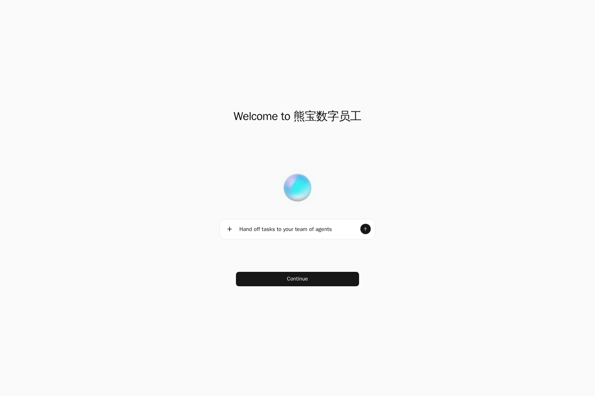

# 熊宝数字员工

熊宝数字员工把对话、数字员工、小组协作、自主工作和任务看板放在同一个工作空间中。
这是基于 CopilotKit OpenBot 开发的私有化版本：账号、对话、任务与审计数据存入自己的 PostgreSQL，
模型由部署方或用户接入。当前目标是 v0.1；浏览器执行、真实模型成功路径及完整发布验收以验收记录为准。

本仓库于 2026 年 10 月 18 日从历史源码副本恢复到 Gitee。恢复文件的时间主要为 2026 年 10 月 10—11 日，不代表原 GitHub 仓库或云端开发环境的最新版本，也不包含原仓库的完整 Git 历史。
当前仓库入口：[Gitee 熊宝数字员工](https://gitee.com/xiongpinji/xiongbaowork)。
恢复范围与验证边界见 [迁移恢复记录](MIGRATION-RECOVERY.md)；部署前需要重新验证。
旧聊天中找回的修复、验收清单和历史证据见 [资料恢复盘点](THREAD-RECOVERY-REPORT.md)。

源码位于 `openbot/`。本仓库的交付路径是 Docker 镜像；Windows 使用 Docker Desktop 的 Linux 容器。
开发环境、历史走查记录与交付部署分别见[部署手册](openbot/docs/deployment-qoderwake.md)、
[开发环境笔记](openbot/docs/development-environment-qoderwake.md)、[B 线验证记录](openbot/docs/track-b-delivery-evidence.md)。



这是未接入模型时的首次启动实测。当前界面中文化和标签页标题的验收状态见
[部署验收记录](openbot/docs/delivery-acceptance-2026-10-09.md)。

## Linux 快速上手

需要 Bash、Git、Docker Engine（含 Buildx）、curl 和 OpenSSL。
当前仓库位于 Gitee，需要有仓库读取权限，并提前完成 Gitee 的 HTTPS 或 SSH Git 认证。
WSL 使用 Docker Desktop 时先启用该发行版的 WSL Integration，并确认 `docker version` 同时显示 Client / Server。
下面只在本机开放 `127.0.0.1:3772`，不配置模型密钥。

```bash
git clone https://gitee.com/xiongpinji/xiongbaowork.git
cd xiongbaowork/openbot
cp docker/delivery.env.example .env.delivery
printf '\nKEY_ENCRYPTION_KEY=%s\n' "$(openssl rand -base64 32)" >> .env.delivery
docker build -f Dockerfile -t xiongbao-digital-employee:local .
docker run -d --name xiongbao-local --env-file .env.delivery \
  -p 127.0.0.1:3772:3001 \
  -v xiongbao-local-db:/var/lib/postgresql \
  -v xiongbao-local-workspace:/workspace \
  -v xiongbao-local-profiles:/profiles \
  xiongbao-digital-employee:local
deadline=$((SECONDS+60))
until curl --fail --silent --max-time 2 http://127.0.0.1:3772/health; do
  if [ "$SECONDS" -ge "$deadline" ]; then docker logs xiongbao-local; exit 1; fi
  sleep 1
done
```

构建需要下载工具链、Chromium 与依赖，首次构建时间取决于网络和磁盘。
浏览器打开 [本机入口](http://localhost:3772)。第一次启动会初始化数据库、运行迁移。
模型尚未接入时不能把“页面可打开”当作“对话已可用”；模型接入见部署手册。

## Windows Docker Desktop 快速上手

先启动 Docker Desktop，切换到 Linux containers；以下在 PowerShell 执行。
不用在 Windows 宿主安装 Bun，也不用重建其他项目的 Compose 栈。
先安装 Git，并完成有仓库读取权限的 GitHub 账号认证；有 GitHub CLI 时同样可用
`gh auth login`、`gh auth setup-git`。确认 `docker version` 同时显示 Client / Server。

```powershell
git clone https://gitee.com/xiongpinji/xiongbaowork.git
Set-Location xiongbao-Wake-/openbot
Copy-Item docker/delivery.env.example .env.delivery
$keyBytes = New-Object byte[] 32
$keyGenerator = [System.Security.Cryptography.RandomNumberGenerator]::Create()
$keyGenerator.GetBytes($keyBytes)
$keyGenerator.Dispose()
Add-Content .env.delivery ('KEY_ENCRYPTION_KEY=' + [Convert]::ToBase64String($keyBytes)) -Encoding ascii
docker build -f Dockerfile -t xiongbao-digital-employee:local .
docker run -d --name xiongbao-local --env-file .env.delivery `
  -p 127.0.0.1:3772:3001 `
  -v xiongbao-local-db:/var/lib/postgresql `
  -v xiongbao-local-workspace:/workspace `
  -v xiongbao-local-profiles:/profiles `
  xiongbao-digital-employee:local
$healthReady = $false
$healthDeadline = (Get-Date).AddSeconds(60)
while ((Get-Date) -lt $healthDeadline) {
  try {
    $healthResponse = Invoke-WebRequest http://127.0.0.1:3772/health -UseBasicParsing -TimeoutSec 2
    $healthReady = $healthResponse.StatusCode -eq 200
  } catch { $healthReady = $false }
  if ($healthReady) { break }
  Start-Sleep -Seconds 1
}
if (!$healthReady) { docker logs xiongbao-local; throw '60 秒内未健康' }
$healthResponse.StatusCode
```

成功应返回 200。浏览器入口也是 [localhost:3772](http://localhost:3772)。
Git Bash 若使用 `docker -v/-w` 的绝对路径，先设置 `MSYS_NO_PATHCONV=1`。
Windows 原生 Bun 在服务端依赖导入链上会挂死；服务端开发与测试使用 Linux/WSL 或容器。

## 配置参考与排障

| 配置 | 用途 |
| --- | --- |
| `KEY_ENCRYPTION_KEY` | 32 字节随机密钥的 base64；升级、恢复时保留同一份 |
| `EMBEDDED_POSTGRES` | `on` 使用持久化内嵌数据库；`off` 使用外接数据库 |
| `DATABASE_URL` | API 运行期非超级用户连接串，角色不能有 `BYPASSRLS` |
| `MIGRATION_DATABASE_URL` | 仅迁移用 owner 串；内嵌数据库由启动脚本产生 |
| `TENANT_PACKAGE_DIR` | 镜像构建期默认 `../examples/qoderwake`；运行期换包不改变已构建 SPA |
| `OPENBOT_RLS_ENFORCE` | 镜像默认 `refuse`；不接受超级用户作为 API 角色 |
| `OPENBOT_SELF_HOST_BANNER` | 镜像默认 `false` |
| `OPENBOT_SINGLE_USER` | 本机体验用 `true`；对外部署用 `false` 并配置登录 |
| `OPENBOT_PUBLIC_URL` | 用户实际访问的地址；本机体验为 `http://localhost:3772` |
| `BOT_MODEL` / `OPENAI_BASE_URL` | 兼容 OpenAI 接口的模型名及 API 地址；名称必须来自供应商当前目录 |

完整配置、登录、Compose、外接数据库、备份与升级见[部署手册](openbot/docs/deployment-qoderwake.md)。

三条配置坑：模型名用 **BOT_MODEL**（`OPENAI_MODEL` 全仓没有读取代码）；
运行期数据库串必须是**非超级用户、无 BYPASSRLS**；
Windows 宿主不能直接 `bun` 起 server，交付路径是**镜像或 Linux/WSL**。

| 现象 | 处理 |
| --- | --- |
| 健康检查没返回 200 | `docker logs xiongbao-local`，检查迁移、密钥、登录配置和端口占用 |
| 日志出现 `rls-not-enforced` 并退出 | 改用非超级用户、无 BYPASSRLS 的运行期连接串；owner 只做迁移 |
| 页面可打开但模型报错 | 核对 `BOT_MODEL`、兼容 API 地址及模型授权；修改后重建容器读取配置 |
| 换品牌包后页面仍是旧品牌 | SPA 品牌在构建期注入，重新构建并更换镜像 |
| 本机端口 3772 被占用 | 更改宿主映射和 `OPENBOT_PUBLIC_URL`，内部端口仍为 3001 |
| Windows 宿主 server 无输出 | 使用镜像或 Linux/WSL，详见开发环境笔记 |

停止体验容器可执行 `docker rm -f xiongbao-local`；命名卷仍然保留。
备份前不要删除数据库卷，升级时不要使用 `docker compose down -v`。

## 与上游及许可的关系

上游项目是 [CopilotKit OpenBot](https://github.com/CopilotKit/OpenBot)。本仓库在其基础上增加
熊宝品牌、任务看板、数字员工与租户能力；不表示由 CopilotKit 提供官方托管或商业支持。
上游源码与原始说明保留在 `openbot/`，根 `.github/workflows/ci.yml` 是本 fork 实际执行的 CI。
上游 `openbot/.github/workflows/` 保留用于同步。

代码沿用 [MIT 许可](openbot/LICENSE)，保留 `Copyright (c) 2026 CopilotKit` 与许可文本。
第三方依赖、品牌素材和模型服务的许可或服务条款各自适用。
