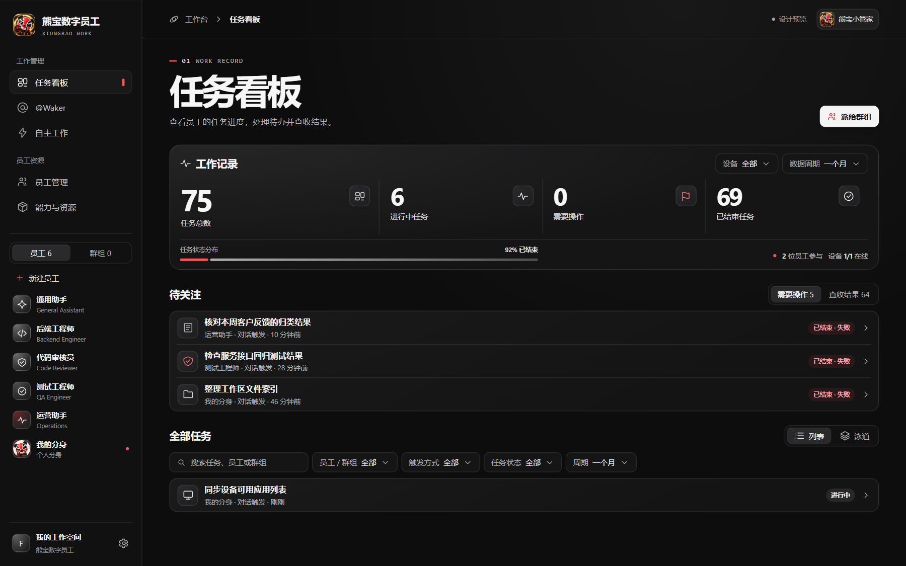

# 熊宝数字员工 · 前端改版设计参考

这套设计以熊宝脸谱的黑、白、红为主色，使用开放式标题、哑光玻璃、细描边和少量红色信号光线。效果图使用示例数据。

## 核心页面

| 页面 | 效果图 |
| --- | --- |
| 任务看板 | [01-任务看板.png](01-任务看板.png) |
| @Waker | [02-Waker.png](02-Waker.png) |
| 自主工作 | [03-自主工作.png](03-自主工作.png) |
| 员工管理 | [04-员工管理.png](04-员工管理.png) |
| 能力与资源 | [05-能力与资源.png](05-能力与资源.png) |

## Claude Code 实施

在 GitHub 云端会话中选用 `codex/ui-design-studio-reference`，从 [完整实施任务书](IMPLEMENTATION.zh-CN.md) 开始，依照现有业务路由和组件实施全站改版。

`index.html`、`theme.css`、`preview.js` 和熊宝图片共同组成离线设计预览。检出本目录后可在浏览器打开 `index.html` 并切换五个页面。实际应用实现位于 `openbot/app`。
