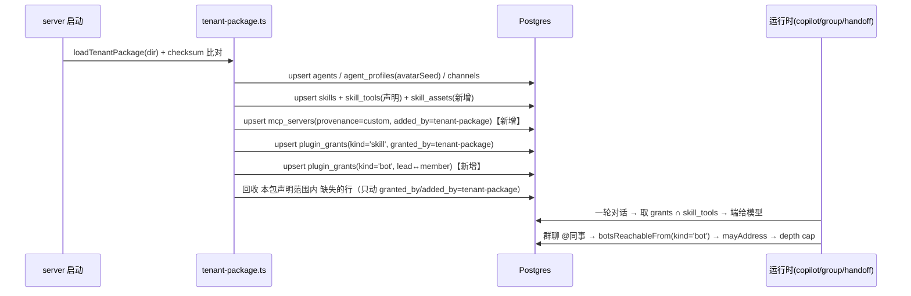

# WorkBuddy 能力资源 → 熊宝数字员工（openbot）移植方案

- 日期：2026-11-12
- 作者：高见远（Architect，software-company 专家团）
- 汇编与事实核验：齐活林（Delivery Director）
- 状态：**待用户确认，未执行，本轮未改动任何源码**
- 目标仓库：`canquedehuiyi-cpu/xiongbaowork`（本地克隆 `xiongbaowork/`，分支 `codex/recovered-source-20261018`）
- 需求原话：「把 workbuddy 上的 专家/专家团、技能/技能包、连接器 直接完整移植到该项目的能力资源中」

## 主理人核验记录（对方案承重假设的独立复核）

方案里三个"可行性依赖"，我在本地逐条跑过，结论如下：

| 方案依赖 | 核验方式 | 结论 |
|---|---|---|
| catalogue 里已有"本地 builtin server"先例，故 `skills/read` 不是新发明 | `grep "kind: \"builtin\"" server/src/plugins/catalogue.ts` | ✅ 成立。`catalogue.ts:306` 的 `routines` 条目，`host: builtin://routines`、`transport: builtin-routines` |
| 群聊 `@同事` 的授权判定确有 `botsReachableFrom` | `grep -rn botsReachableFrom server/src` | ✅ 成立。`agents/handoff-tool.ts:347` 定义、`:404` 作为 `mayAddress` 判据；`index.ts:1600` 注入 |
| 现有品牌包基线是 5 员工 / 5 技能、`product_name` 已是熊宝 | `grep -c` + 读 `brand.yaml` | ✅ 成立。`agents.yaml` 5 条、`skills.yaml` 5 条、`brand.yaml:5 product_name: 熊宝数字员工` |

**一处勘误**：方案 P1 写"新增迁移 `server/drizzle/00XX_skill_assets.sql`"，实际当前最大编号是 `0080_wakerflow_quota_contracts.sql`，新迁移应为 **`0081_skill_assets.sql`**。

**一处补漏**：P0 要在 `openbot/package.json` 注册 `port:capabilities` script，否则验收命令跑不起来（方案正文的产出清单漏了这一项）。

---

# 方案正文

## 0. 执行前置：推送通道（必须先解决，否则一切交付无处落地）

| 通道 | 现状（实测） | 判断 |
|---|---|---|
| GitHub `canquedehuiyi-cpu/xiongbaowork` | `gh` 登录账号 `xiongpinji` token 失效；API 返回 403「account was suspended」 | **当前不可用**。不是权限问题，是账号被封，换 PAT 无效 |
| gitee `xiongpinji/xiongbaowork.git` | 本地 `origin` 指向它，工作区干净 | **当前唯一可用通道** |

**结论**：所有阶段交付默认推 `origin`（gitee），分支命名沿用现有习惯 `feat/capability-port-<phase>`。GitHub 侧等账号恢复或改用新 org 后再做一次镜像推送，方案里不假设 `gh` 可用。这一条不是技术风险，是**排期风险**——需要开工前拍一次。

---

## 1. TL;DR 与规模判断

**结论**：能移植，而且落点出奇地顺——"专家/专家团/技能/连接器"四类资产，在 openbot 里都能找到天然载体（`agents/` + `channels` + `plugin_grants(kind='bot')` + `skills` + `mcp_servers`）。真正的成本**不在搬文件，在三处契约缺口和一层工具名语义落差**：WorkBuddy 技能正文写的是 `Read/Bash/Grep/WebFetch/Task`，而 openbot 员工手上只有 12 个 `computer_*` 工具，**没有本地 shell**。因此"移植成功"必须重新定义，否则会得到一堆"文件在、点了没反应"的技能。

**"完整移植"在工程上指**：

| 指 | 不指 |
|---|---|
| 每个 WorkBuddy 概念在目标系统里有**唯一且有语义的载体**（见 §3 映射表） | WorkBuddy 运行时语义等价（本地 shell、`Read` 门禁、`scripts/` 可执行、hooks） |
| L0 全部内容**可被发现**（员工列表 / `/` 菜单 / 连接器页）、**可被授予**、**可被调用** | 把 428 专家 + 293 技能 + 298 连接器的原始目录（约 74MB+）逐字节塞进 git |
| 专家团具备**可运行的多员工协作**（lead 在群里 `@` 成员，受 grant 约束、受 depth/fan-out cap 约束） | 把 WorkBuddy 侧的凭证、授权状态、会话记忆迁过来 |
| 每条内容带**可审计的许可与来源字段**（§6） | 保证 100% 技能"移植后行为一致"——做不到，且必须显式标记降级 |

**工作量量级**（单人，含自测）：

| 档位 | 内容 | 交付到"可运行" | 主要成本构成 |
|---|---|---|---|
| **L0** | 9 专家包（→23 个 agent + 3 个团）+ 60 技能 + 3 连接器 | **9–14 人日** | 契约扩展 3 处（40%）、工具映射层（25%）、内容转换与去重（20%）、e2e（15%） |
| **L1 增量** | 428 专家 + 293 官方技能 + 298 连接器定义 | **+8–12 人日** | 抓取管道 + 许可审查（60%）、抽查可跑性（40%）；**搬运本身接近 0** |
| **L2** | SkillHub 15 万+ | **不可批量交付** | 只能做"按需安装"通道，见 §2 |

推荐：**先做 L0 全链路打通（含三处契约扩展），L1 只做"可安装通道 + 白名单"，L2 明确不做。**

---

## 2. 移植分层

### 2.1 三档范围

| | L0 本机已装 | L1 官方全市场 | L2 社区 SkillHub |
|---|---|---|---|
| 专家 | 9 包 → **23 个 agent**（3 lead + 15 member + 5 独立，去重 1 个重复包） | 428 包 → 估 1000+ agent | 无权威计数 |
| 技能 | **60 个**（用户级 43 + 专家包内置 17，见下方对账） | 293 官方技能（`skill-marketplace.zip` ≈30MB） | 15 万+ |
| 连接器 | **3 个**已授权（github / tapd / tencent-docs） | 298 个定义（63MB）：**239 条 url 形态可搬 / 15 条 `command` 形态不可搬 / 44 个目录无 `mcp.json`**；其中认证可自动接通的仅 5 条 oauth，81 条 `server-side`+`token` 在 openbot 凭证模型里无法迁移（见 §4a-2） | — |
| 入仓体积 | ≈2–3MB 正文 | **禁止入仓**（见 §6） | 禁止 |
| 许可风险 | 中（市场包再分发权未明示） | 高（同 L0 且规模大） | 高 |
| 成本 | 9–14 人日 | +8–12 人日 | 无法估 |
| 推荐 | ✅ 做 | ⚠️ 只做通道 + 白名单 | ❌ 不做批量 |

**技能数 60 的对账（2026-11-12 实测修正，原方案写 42 是错的）**：

| 来源 | 数量 | 说明 |
|---|---|---|
| 用户级技能目录 | 43 | `~/.workbuddy/skills` 下 44 项，其中 `_bm_skillid_migration.json` 是文件不是技能 |
| 专家包内置技能 | 19 | 9 个 `plugin.json` 的 `skills[]` 声明合计 |
| 减：整包重复 | −1 | `ex_eqoqYRT1NIwb` 与 `engineering-workflow-skills` 同 name+version，按 checksum 去重 |
| 减：内容重复 | −1 | `senior-developer/browser-use` 与 `frontend-developer/browser-use` 逐字节相同 |
| **合计** | **60** | 43 + 17 |

原方案写 42 有两处错误：把技能目录数当成 44（实为 43），且**整个漏掉了 17 个专家包内置技能**——而 `agents.yaml` 的 `skills[]` 有 17 处引用它们，漏掉就等于 17 个悬空授权。用户已拍板"三个 `dev-expert` 全部保留、slug 加来源后缀"，故不做合并，43 条全留。

### 2.2 L1 的正确做法：不搬内容，搬"可安装通道"

`skill-marketplace.zip` 与专家 COS bundle 是**部署时抓取物**，不是源码。方案：

1. 新增 `openbot/scripts/fetch-capabilities.ts`：从官方 URL 下载 → 解压到 `openbot/.cache/capabilities/`（**`.gitignore`**）→ 计算每包 sha256 → 写 `openbot/capability-lock.yaml`（**入仓**）。
2. 转换器（§7 P0）从 `.cache/` 读，不直接读 `~/.workbuddy/`；好处：CI 可复现，且不依赖某个人机器的目录布局。
3. 只有 `capability-lock.yaml` 里 `redistributable: true` 且过了 `--only=<whitelist>` 的条目才进品牌包。

这条设计的意义：**L1 的"完整性"由锁文件表达，不由 git 内容表达**。评审时看锁文件（几百行）而不是看 293 个目录。

---

## 3. 落点映射表

一次启动写入链路（整个方案的骨架）：



### 3.1 逐概念映射

| # | WorkBuddy 概念 | openbot 载体 | 判定 | 要点 |
|---|---|---|---|---|
| 1 | 专家（`expertType: 'agent'`） | `agents.yaml` 条目 + `agent_profiles.avatarSeed` | **需转换** | `agents/*.md` 正文 → `system_prompt`；`displayName.zh`→`name`，`profession.zh`→`title`，`displayDescription.zh`→`role_description`；`type: built-in` |
| 2 | 专家团（`expertType: 'team'`） | lead/member 各一个 agent **＋ 新增 `teams.yaml`** → 物化为 `channels` + `plugin_grants(kind='bot')` 双向 | **需扩展契约** | 见 §4b。团队语义没有结构化表，落三处：channel 成员、bot grant（决定能不能 `@`）、lead prompt 的"团队段" |
| 3 | `members[].role` | lead 的 `system_prompt` 追加一段 + `teams.yaml` 的 `role`（仅声明，不建表） | **需转换** | 注意：`responsibilities` 表**不是**这个——它是带 trigger/run 的定时职责，语义不同 |
| 4 | 技能（`skills/<name>/SKILL.md`） | `skills.yaml` 条目 | **需转换** | frontmatter `name`→`slug`（归一化见 §3.2），`description`→`summary`（压成一行），`description_zh` 优先；正文→`instructions` |
| 5 | 技能包（包内自带 skills） | 同 #4，额外记 `skill → source package` 于 manifest | **直接映射** | 包内技能与用户级技能统一进同一 `skills.yaml`；绑定发生在 `agents.yaml` 的 `skills[]`。**以 `plugin.json` 的 `skills[]` 声明为准**：目录里存在但未被声明的技能不移植（`code-architect-expert/skills/architecture-reference` 就是这种，移植它等于给员工发一个作者故意没绑的技能） |
| 6 | 连接器（`mcp.json` 的 `mcpServers.<id>`） | **新增 `connectors.yaml`** → `mcp_servers`（`provenance='custom'`） | **需扩展契约** | 见 §4a。`<id>` 直接作为 `serverId`（工具 ref 前缀） |
| 7 | 连接器附带的 `skill/SKILL.md` | **无载体，不移植** | **不可移植** | 实测全市场只有 1 个连接器带 `skill/` 目录（`github`），且该文件通篇是"先安装连接器再用"的说明——openbot 侧连接器由 `connectors.yaml` 声明即可用，整篇没有可移植内容。记入该 connector 的 `dropped` |
| 8 | 头像（`avatars/*.png`） | `agent_profiles.avatarSeed` | **不可移植（图片）** | 图片不进库；`avatarSeed = slug` 保持稳定唯一；要真图走部署侧挂载 |
| 9 | 技能多文件附件（`references/` `templates/`） | `skill_assets`（新增表）+ 内置工具 `skills/read` | **需扩展契约** | 见 §4c |
| 10 | 技能 `scripts/`（`.py`/`.sh`） | **无载体** | **不可移植** | 无 shell、无 Python；manifest 标 `scripts: dropped`，正文改写成"本环境不可执行" |
| 11 | `allowed-tools` frontmatter | `skill_tools` 声明（`<serverId>/<toolName>`） | **需转换** | 过 §5 映射层；无法映射的**丢弃并记 manifest**，不留悬空 ref |
| 12 | 专家 `skills[]` | `agents.yaml` 的 `skills[]` → `plugin_grants(kind='skill')` | **直接映射** | 已支持，`granted_by='tenant-package'` |
| 13 | 群聊里 lead `@` 成员 | `channels` + `plugin_grants(kind='bot')`；`botsReachableFrom` 读 kind='bot'；`agents/handoff.ts` 的 depth cap / fan-out cap 已存在 | **直接映射（授权侧需扩契约）** | **不写 bot grant 就 `@` 不动**，这是最容易漏的一步 |
| 14 | `plugin.json` 元数据 | `capability-manifest.yaml`（新增） | **需转换** | 来源、版本、许可、checksum 全在这（§6.4） |

### 3.2 命名归一（必须先做，否则导入即冲突）

事实：`skills.slug` 有全局唯一索引（`skills_slug_key`）。而 WorkBuddy 侧实存重名：`dev-expert` 三个来源版本 + `dev-expert-pro` + `dev-god`。

规则：
- `slug = kebab(sourceName)`；冲突时追加来源后缀：`dev-expert__skillhub`、`dev-expert--indiv-weishui`。
- 同一 `name+version` 的重复下载（`ex_eqoqYRT1NIwb` vs `engineering-workflow-skills`）→ **按 checksum 去重，保留可读的目录名**。
- 冲突不是错误，但要产出 `docs/porting/slug-conflicts.md` 让人过一遍，避免"两个 dev-expert 谁被谁覆盖"这种无声事故。
- **跨包冲突时裸名必须给用户级**：同一个 `fullstack-dev` 既是专家包自带技能又是用户级独立技能、且两者内容不同时，裸 slug 给用户级那份，包内那份加包名后缀。禁止"包内那份抢到裸名"——它会让用户 `/fullstack-dev` 调到一份自己没见过的指令，界面上看不出来。

---

## 4. 三处契约缺口的处置

### 4a. 品牌包不能声明连接器

**路径 A1：扩契约，新增 `connectors.yaml`（推荐终态）**

```yaml
connectors:
  - id: github            # 同时是 serverId，也是工具 ref 的前缀
    title: GitHub
    vendor: GitHub
    url: https://api.githubcopilot.com/mcp/
    host: api.githubcopilot.com   # 必须与 url 的 host 逐字符相等，否则拒绝加载
    auth: user-oauth              # deployment-bearer | user-oauth | none
    credential_env: GITHUB_MCP_CREDENTIAL_ID   # 只声明变量名，绝不写值
    docs_url: https://...
    write_tools: [create_pull_request, merge_pull_request]
```

- 同步：写 `mcp_servers(provenance='custom', added_by='tenant-package', catalogue_key=null)`；`credentialId` 留空，启动时若 `credential_env` 命中的凭据行存在才绑定，否则"能力与资源"页显示"待绑定"。
- 回收：只删 `added_by='tenant-package'` 且本包声明集合之外的 id；`mcp_tools` 已有 `onDelete: cascade`；同时清 `plugin_grants`/`skill_tools` 里指向该 server 的 ref。
- 风险面：包的 url 由包作者决定 → 用 `host` 锚定（与 `CatalogueEntry.host` 同等审查强度）+ **永不自动绑定凭证**（`mcp_servers.credentialId` 的 FK 是 `restrict`，这里刻意留 null）。
- 成本：`tenant-package.ts` +250~350 行、1 个测试文件、0 迁移。

**路径 A2：不动契约，一次性脚本（零侵入）**

`openbot/scripts/bootstrap-connectors.ts` 调已有的 `pluginStore.addCustomServer()`（`plugins/store.ts:2818`）把 3 个连接器写进库。
- 优点：今天就能通，零契约风险，1 人日。
- 缺点：不可复现（换机/新租户要重跑）、不在 checksum 保护内、"能力与资源"页看不到归属。

**推荐：A2 → A1，分两步**。P2 先用 A2 打通 3 个连接器并验证工具可被 grant；P1 做完 A1 后把 A2 降级为"无包环境下的兼容入口"。

#### 4a-2 认证方式不能从 `mcp.json` 推导（L1 的硬约束）

上面 `connectors.yaml` 的 `auth: user-oauth | deployment-bearer | none` 看起来是转换器"看一眼就能填"的，实际填不出来。`mcp.json` 是**上游厂商的公开形态**，不是认证明细；WorkBuddy 自己的凭证注入是平台级的一次性请求期 header 改写（`connectors.json` 顶层的 `auth_injection_rules`，形如 `{"from_connector":"tencent-docs","token_type":"mcp-oauth","inject":[{"header":"Authorization","value_template":"Bearer ${access_token}"}]}`），这套东西依赖它自己的 token 代理，**在 openbot 侧不存在**。

实测 298 个连接器的 `auth_mode` 分布（2026-11-12 本机统计）：

| `auth_mode` | 条数 | 能否映射到 openbot 的凭证模型 |
|---|---|---|
| 未声明（字段缺失） | 210 | **不能自动推导**——缺字段不等于不需要凭证 |
| `token` | 69 | 需人工指定 header 名与值模板，`user-oauth` 无法覆盖 |
| `server-side` | 12 | **结构性不可能**：凭证在厂商侧代持，openbot 无对应形态 |
| `oauth` | 5 | 可映射 `user-oauth`，需逐条填 authorization/token URL |
| `oneid-token` / `mcp` | 1 + 1 | 需人工判断 |

结论（比原方案更保守，请以此为准）：
1. **`server-side` 与 `token` 两类（81 条）在 openbot 的凭证模型里带不过去**，只能靠"用户在 UI 里自己填一个 header 覆盖"兜底，而这需要在 P1 的 `connectors.yaml` 之外再加一个 `header_overrides` 声明字段——**不在当前契约里**。
2. 能做的是：`connectors.yaml` 只写 `url / host / vendor / title`，`auth` 一律先落 `unknown`，`credential_env` 留空；管理员在"能力与资源"页逐条绑定。**不要把"能声明"误当成"能认证"。**
3. 因此 L1 的 298 个连接器，可自动搬迁的是 **239 条 url 形态**（`command` 形态 15 条直接丢弃，44 个目录没有 `mcp.json`），其中**真正能按 `user-oauth` 自动接通的上限是 5 条（oauth）+ 少量人工判定**。这个比例必须写进 L1 的对外承诺，否则"移植了 298 个连接器"是假的。

### 4b. 品牌包不能声明专家团/群组编排

**路径 B1：零 schema，`teams.yaml` → channel + bot grant + prompt（推荐）**

```yaml
teams:
  - id: software-company
    name: 软件公司
    description: 一个 lead 带四个成员，按需把活交出去
    channel: software-company
    lead: software-company-lead
    members:
      - id: software-company-pm
        role: 产品经理    # 只进 teams.yaml 与 lead 的 prompt，不建表
    address:            # 谁可以 @ 谁，物化为 plugin_grants(kind='bot')
      - from: software-company-lead
        to: [software-company-pm, software-company-engineer, software-company-architect, software-company-qa]
```

- 物化三件事：① `channels`（`permitted_agents` = 全团）；② `plugin_grants(kind='bot')`——`mayAddress` 的唯一依据；③ lead 的 `system_prompt` 追加"你的团队 + 交接规则"段。
- 优点：**0 迁移、0 新表**，完全复用既有 `botsReachableFrom` / depth cap / fan-out cap / 群消息 thread 机制。
- 缺点：没有"组织结构"数据；成员仍独立出现在员工列表（**不能"藏在团里"**）；跨团 `@` 必须显式声明 grant。

**路径 B2：新表 `agent_teams` + `agent_team_members` + UI**
- 缺点：与 `channels` + `plugin_grants` **同一事实写两处**——本仓库反复强调的反模式（见 `mcp_servers.provenance` 与 `url` 的 "ONE FACT IN TWO PLACES" 注释）；两表 + 迁移 + 两个页面 ≈ 5–7 人日，收益只有"UI 里能编辑"。

**推荐 B1**。B2 等到"用户要在 UI 里改团队"这个需求真的出现再做。

### 4c. 技能不支持多文件附件（渐进式披露）

WorkBuddy 技能的核心机制是"SKILL.md 入口 + 按步 `Read` references"（`dev-expert` 明写"未读 = 该步门禁未生效"）。目标系统 `skills.instructions` 是**单段 text**。

**路径 C1：内联压平** — `references/` 拼到 `instructions` 尾部附录。
- 优点：0 改动，今天可跑。
- 缺点：渐进式披露消失；正文 4KB → 20–60KB。
- **成本口径修正（P0 实测后）**：`skills.instructions` 不是每轮都插——只有该技能被 `/slug` 调用时才前插本轮，参与工具筛选的是 `summary`（一行）。所以 C1 的代价是"调用那一次多十几 KB 上下文"，不是"每轮翻十倍"。P0 实测 60 条 instructions 合计 806KB、均值 13.4KB。真正的风险只在**少数超长技能**（20–60KB）一次吃掉大半上下文预算——这正是 C2 只对超额条目启用的理由。

**路径 C2：`skill_assets` + 内置读工具（推荐终态）**
- 新表 `skill_assets(tenantId, skillId, path, mediaType, content, bytes, checksum)`，PK `(skillId, path)`，`onDelete: cascade`。
- 新内置 server `skills`，工具 `skills/list` / `skills/read`，ref 形如 `skills/read`。**先例已核验存在**：`catalogue.ts:306` 的 `routines` 是 `host: builtin://routines` 的 builtin 条目。
- 运行时：`instructions` 尾部追加机器生成的附件清单（`- references/step-3.md（8.2KB）：第三步细则，执行前必须读完`）。
- 校验：`skills/read` 只允许读**调用者已获 grant 的技能**的附件，越权直接 refuse（必须单测）。
- 成本：1 张表 + 1 迁移 + 1 个工具 + 授权面 + 回收逻辑，≈4–5 人日。

**推荐：双轨制，阈值 24KB**。≤24KB 走 C1 内联；>24KB 走 C2（`dev-expert`、`frontend-developer`、`humanize-ppt-team` 的技能大概率在这档）。**阈值必须写进 manifest**，否则半年后没人知道为什么有的技能能 `Read` 有的不能。

---

## 5. 工具名映射层

### 5.1 事实对照

| WorkBuddy 正文里的写法 | openbot 现状 | 等价度 |
|---|---|---|
| `Read(path)` | `computer_read_file` | 部分（无工作区/行号语义） |
| `Write(path)` / `Edit(path, old, new)` | `computer_write_file` | 部分（**无 diff/patch**） |
| `Glob(pattern)` | `computer_list_files` | 部分 |
| `Grep(pattern, path)` | **无** | 需 shim |
| `Bash(cmd)` | **无 shell、无 Python、无 Node** | **不可等价** |
| `WebFetch(url)` | `computer_navigate` + `computer_read` | 部分 |
| `Task(subagent)` | 无子代理；对应物是 handoff（`@同事`） | 语义不同（异步、需授权、有深度上限） |
| `Skill(slug)` | `/slug` 技能本身 | 直接 |
| `mcp__<server>__<tool>` | `<serverId>/<toolName>` | 直接 |

补充约束：`SELECTION_FLOOR = 12`（`plugins/selection.ts:82`）——工具数 ≤12 时不筛选，全给。多数员工授权工具数低于 12，意味着**技能声明的 `tools` 在 L0 阶段基本不起作用**；不要指望"声明式收窄"救 token，收窄要靠 §4c 的附件设计。

### 5.2 策略：改写为主，shim 为辅，语义落差如实标注

1. **改写（必做）**：`tools/port-capabilities/rewrite-toolrefs.ts`，一张映射表 + 正文首部插入"环境事实"段：
   > 本环境没有 shell，也没有 `Bash`；文件读写只有 `computer_read_file` / `computer_write_file`（作用于你自己的电脑，不是服务端容器）。需要真正执行命令时，不要伪造结果——把这一步交给"在我电脑上跑"。
2. **shim（只做两个）**：
   - `skills/read`（§4c）—— 唯一必须；
   - `fs/grep` **不做**。它需要落到"谁的机器"上，而设备通道已有"在我电脑上跑"这条正路。语义半吊子的 grep 只会让模型误以为自己在 Linux 上。
3. **不可等价的部分（Bash / Task / 可执行 scripts）**——不 shim，改写成"降级说明"，manifest 打标。诚实降级好过假装能跑。

### 5.3 自动检测"移植后不可执行"的技能清单（必交付物）

`tools/port-capabilities/audit-toolrefs.ts` 静态扫描每条 `instructions`：

| 规则（正则族） | 判定 |
|---|---|
| `/\b(Read|Write|Edit|MultiEdit|Glob|Grep|WebFetch)\(/` | 命中→查映射表，缺映射则 `degraded` |
| `/\bBash\(/` 或正文出现 `bash`/`sh`/`python3`/`node` 后跟空白（**行内命令**） | `blocked` |
| `/mcp__([\w-]+)__([\w-]+)/` | `serverId` 不在 `connectors.yaml` → `blocked` |
| `/\bTask\(/` | `degraded` |
| 引用 `scripts/` 下文件 | `blocked` |
| 引用 `references/` 且未走 C2 | `degraded` |

产出 `docs/porting/tool-ref-audit.md`：每个技能一行 → `slug / runnable(full|degraded|blocked) / 命中引用 / 原因 / 建议`。**这张表是"到底移植成功了百分之几"的唯一可信答案**，不要用文件数汇报。CI 里作非阻断检查。

> 主理人补充的量化基线：我扫了本机 44 个技能的 `SKILL.md` 正文，**20 个**命中 `Bash`/`Read`/`Write`/`Grep`/`mcp__` 引用（含 dev-expert 全系 4 个变体、agent-team-orchestration、hash-bound-review-loop、hostile-git-repo-recovery、windows-pc-tuneup 等），**24 个**为纯指令型。这条基线可与审计器的输出对账。

**围栏规则（P0 实测补充，必须照此实现）**：```bash 代码围栏本身不算"执行命令"——很多技能只是用它排版。规则只看**行内**可执行命令（`Bash(` 调用、`bash ` / `sh ` / `python3 ` / `node ` 后跟空白）。若把围栏也算命中，会多误判 8 个仅用围栏排版的技能。**但围栏内部的命令行仍按行内命令判 `blocked`**。

**已知误报（P0 实测，P3 自然消解）**：`software-engineer` 的 system_prompt 里有句 "Do NOT run bash commands…"，是否定句但按字面命中。不特判否定词（不可靠），P3 改写正文时消除。

**P0 实测分档**：60 条技能中 34 full / 26 blocked / 0 degraded。`degraded` 为 0 是因为本语料里会命中的 `Read(...)`、`Task(...)`、缺附件三条规则，只在 `darwin-skill` 上出现过一次，而它同时命中 `scripts/` 被升级成 blocked（严重度取最坏）。**这提示 `degraded` 档在 P3 真正改写正文之前基本不会出现，"降级"主要走 prompt 内联说明而不是正文改写档位。**

---

## 6. 数据与许可

### 6.1 什么能入仓

| 内容 | 入仓 | 理由 |
|---|---|---|
| 转换脚本、审计器、抓取器 | ✅ | 我们自己的代码 |
| 生成的 `agents.yaml` / `skills.yaml` / `teams.yaml` / `connectors.yaml` / `capability-manifest.yaml` | ✅ | 转换产物，体积可控 |
| L0 的 `SKILL.md` 正文 + ≤24KB 的 references | ✅（≈2–3MB） | 需评审、需 diff |
| `capability-lock.yaml` | ✅ | 完整性靠锁文件表达 |
| L1/L2 原始正文与 63MB 连接器目录 | ❌ | 见下 |
| `.credentials.v3.json` | ❌ **绝对禁止** | 加密凭证，入仓即事故 |
| `model.yaml` 里的凭证真值 | ❌ | 只允许写变量名 |
| `avatars/*.png` | ⚠️ 默认不入 | 用 `avatar_seed` 派生 |
| `scripts/*.py|*.sh` | ❌ | 不可执行，且许可最杂 |

### 6.2 许可风险与处置

| 资产 | 许可状态 | 处置 |
|---|---|---|
| openbot 源码 | MIT（`Copyright (c) 2026 CopilotKit`） | 保留 `LICENSE` 与版权行；派生作品继续 MIT |
| WorkBuddy 官方技能/专家包 | **再分发权未声明** | 默认 `redistributable: false`，不入 git；部署时抓取 |
| 社区 SkillHub 技能 | 各异（`license` 字段只有 5/44 填了） | 只允许人工逐个确认后进白名单 |
| 第三方连接器 `mcp.json` | 描述性配置，风险低 | 可入仓，每条带 `source_url` |

### 6.3 MIT 与闭源收费的边界

| 允许 | 必须 | 禁止 |
|---|---|---|
| 闭源分发私有修改、按订阅收费 | 分发（含 Docker 镜像）时随附完整 MIT 文本与原版权声明 | 移除/替换 `Copyright (c) 2026 CopilotKit` |
| 新增文件里加 `Copyright (c) 2026 熊宝` 并采用不同许可 | 明确声明"基于 OpenBot（MIT）构建" | 用 `CopilotKit` 商标做产品名/域名 |
| 对衍生整体主张商业条款 | 向取得二进制者提供源码获取方式 | 把上游既有文件改成专有许可 |

一条容易踩的坑：**转换器放进 MIT 仓库，它就是 MIT 的**，竞品可拿去用。若不能接受，转换器必须放独立私有仓库、构建时以 artifact 注入。这是取舍，不是技术问题。

### 6.4 每条必须携带的许可字段（`capability-manifest.yaml`）

```yaml
- kind: skill            # agent|skill|connector|team
  slug: dev-expert
  source: "workbuddy skill-marketplace:dev-expert@2.0.3"
  source_url: https://download.codebuddy.cn/...
  source_version: 2.0.3
  fetched_at: 2026-10-18T00:00:00Z
  checksum_sha256: <64hex>
  license: "proprietary-workbuddy-marketplace"
  redistributable: false
  attribution: "© WorkBuddy"
  runnable: degraded       # full|degraded|blocked
  dropped: ["scripts/", "references/large/**"]
```

**这 9 个字段缺一个，条目不许进包**——在转换器里做硬校验，不靠人记。

---

## 7. 分阶段任务列表

依赖：P0 → P1 → P2 → P3 → P4 → P5（P4 与 P3 可并行）。所有阶段默认推 gitee `origin`，分支 `feat/capability-port-p<N>`。

### P0 移植管道骨架（纯新增，零侵入）

| 项 | 内容 |
|---|---|
| 产出 | `openbot/tools/port-capabilities/{index.ts, read-workbuddy.ts, normalize.ts, emit-package.ts, manifest.ts, audit-toolrefs.ts, mapping.ts}` + `*.test.ts`；`openbot/scripts/fetch-capabilities.ts`；`openbot/capability-lock.yaml`；`.gitignore` 增 `.cache/capabilities/`；**`openbot/package.json` 注册 `port:capabilities`** |
| 验收 | `bun run port:capabilities -- --source ~/.workbuddy --only=l0 --out ./tmp/p1` 与 `--out ./tmp/p2` 各跑一次；`bunx biome lint tools/port-capabilities` 干净；`diff -r tmp/p1 tmp/p2` **无差异**（幂等）；`tmp/p1/capability-manifest.yaml` 条目数 = 23 agent + 60 skill + 3 connector + 3 team |
| 规模 | 新增 ≈1800 行 TS + 3 测试文件，**改动既有文件 0 个**（除 package.json 一行） |
| 回滚 | `git rm -r tools/port-capabilities ...`，运行时零影响 |

### P1 三处契约扩展（server 侧）

| 项 | 内容 |
|---|---|
| 产出 | 改 `server/src/tenant-package.ts`（**新逻辑放独立文件 `server/src/tenant-package-capabilities.ts`，主文件 ≤40 行接入**，压缩 diff 面积以还上游同步债）；改 `server/src/db/schema/plugins.ts`（`skillAssets`）；新增 **`server/drizzle/0081_skill_assets.sql`**；改 `server/src/plugins/catalogue.ts`（builtin `skills` 条目）；新增 `server/src/skills/assets-store.ts` + `read-tool.ts`；新增测试 `tenant-package-connectors.test.ts`、`-teams.test.ts`、`-skill-assets.test.ts`、`skill-assets-tool.test.ts` |
| 验收 | `bun run typecheck` 全绿；`cd server && bun run db:generate` 与手写迁移一致；`bun test server/tests/tenant-package.test.ts server/tests/tenant-package-switch-retires.test.ts` 全绿（**回归证明旧包行为不变**）；新增用例覆盖：①只回收 `added_by='tenant-package'` 的连接器行 ②`teams.yaml` 双向 bot grant 落库 ③跨员工读附件被拒 |
| 规模 | 改 ≈600–900 行（新文件 500+，主文件 diff ≤40 行），+1 迁移，+4 测试文件 |
| 回滚 | 三个 YAML 均 optional；`TENANT_PACKAGE_DIR` 指回 `examples/qoderwake` 即恢复；迁移只加一表 |

### P2 L0 内容落地（并入现有品牌包）

| 项 | 内容 |
|---|---|
| 落点决定 | **并入 `openbot/examples/qoderwake/`**（已是"熊宝数字员工"品牌包，`product_name: 熊宝数字员工`），不新建并行包——两个包会导致部署只能二选一，能力资源就"不在产品里"了 |
| 产出 | `examples/qoderwake/agents/*.yaml`（23 个，目录式，复用 `PackageAgentFile` 既有约定）；`skills.yaml` 扩到 65 条（5 现有 + 60 新）；`skills/<slug>/`（超阈值附件）；`teams.yaml`（3 团）；`connectors.yaml`（3 个）；`capability-manifest.yaml`；`channels.yaml` 增 3 条团队频道；`brand.yaml` 不动 |
| 验收 | `TENANT_PACKAGE_DIR=../examples/qoderwake bun run generate:app-config` 成功；`server/tests/qoderwake-package.test.ts` 断言 agent=28（5+23）、skill=65（5+60）、team=3、connector=3；连续 `synchronizeTenantPackage` 两次后 `agents` 行数不变（幂等）；`bun test server/tests/qoderwake-package.test.ts` 全绿 |
| 规模 | 生成物 ≈120 文件 / 正文 2–3MB；手写 ≤15 文件 |
| 回滚 | 新文件独立目录 + 4 个新 YAML；`git revert` 后重启即恢复 |

### P3 工具映射层闭环

| 项 | 内容 |
|---|---|
| 产出 | `tools/port-capabilities/rewrite-toolrefs.ts`；`docs/porting/tool-ref-audit.md`（**交付物**）；`skills/read` 接入 copilot 工具面；把 >24KB 技能切到 assets；`manifest.runnable` 回填 |
| 验收 | `bun test server/tests/plugin-catalogue.test.ts server/tests/skill-assets-tool.test.ts` 全绿；审计报告 `blocked` 数与人工抽样一致（抽 5 个手读确认）；未 grant `skills/read` 的员工调用它 → 拒绝 |
| 规模 | 新增 ≈700 行，改 `catalogue.ts` ≈60 行 |
| 回滚 | 新工具未被 grant 即不可达；删 catalogue 条目即回退 |

### P4 能力与资源页面并联（前端）

| 项 | 内容 |
|---|---|
| 产出 | 改 `app/src/routes/_authed/_app/resources.tsx`（该页定位就是"一个员工被给了什么"的单一列表，团队与连接器必须出现）；新增 `app/src/components/resources/{team-card.tsx, connector-card.tsx, runnable-badge.tsx}`；改 `app/src/lib/plugins/queries.ts` |
| 验收 | `bun --filter app typecheck` 全绿；`bun test app/tests/*resources*` 全绿；手工：该页出现"3 个团队 / 3 个待绑定连接器 / 42 个技能，其中 N 个降级" |
| 规模 | ≈400 行 + 2 测试文件 |

### P5 端到端 + 文档 + 交付

| 项 | 内容 |
|---|---|
| 产出 | `server/tests/port-l0-endtoend.integration.test.ts`；`docs/porting/{README.md, manifest.md, tool-ref-audit.md, slug-conflicts.md}`；`openbot/docs/deployment-qoderwake.md` 增一节"能力资源与其降级说明" |
| 验收 | §8 全部命令全绿；`bun run test:ci` 全绿；`OPENBOT_SMOKE=1 bun test tests/smoke` 全绿 |
| 规模 | ≈900 行测试 + 4 篇文档 |

---

## 8. 验证方案

分四层，**每层都有可执行命令**。缺任何一层，"成功"就只是自我感觉。

### L1 静态层

| 检查 | 命令 | 期望 |
|---|---|---|
| 类型 | `cd openbot && bun run typecheck` | exit 0 |
| Lint | `bunx biome lint --error-on-warnings .` | exit 0 |
| 包校验 | `bun test server/tests/tenant-package.test.ts tenant-package-duplicates.test.ts` | 全绿（新增 YAML 不许让既有校验放宽） |
| manifest 完整性 | `bun run port:capabilities -- --verify ./examples/qoderwake` | 9 个许可字段齐备，缺一 exit 1 |
| 幂等 | 转换器跑两次 `diff -r` | 无差异 |

### L2 单测/集成层

| 检查 | 命令 | 期望 |
|---|---|---|
| 品牌包切换回收 | `bun test server/tests/tenant-package-switch-retires.test.ts` | 全绿。**本次最危险的回归点**：新增 3 类可写行，回收写宽会删掉别的包 |
| 技能声明不授权 | `bun test server/tests/skill-tools.integration.test.ts` | 全绿 |
| 附件越权 | `bun test server/tests/skill-assets-tool.test.ts` | 读别人的附件被拒 |
| 连接器不自动绑凭证 | `bun test server/tests/tenant-package-connectors.test.ts` | `credential_id is null` |

### L3 端到端（这才是"移植成功"的定义）

`server/tests/port-l0-endtoend.integration.test.ts`，一条用例串起来：

1. 起测试库 → `synchronizeTenantPackage("../examples/qoderwake")`；
2. **员工列表 28 人**（5 现有 + 23 移植），`avatar_seed` 唯一；
3. 以某人身份 `/dev-expert` 调技能 → 断言本轮 prompt **前插了 instructions**，可用工具 = `grants ∩ skill_tools`；
4. `software-company` 频道让 lead 发 `@某成员` → `group_messages` 出现交接、`agent_handoff` 队列有该 hop；**删掉 lead→member 的 bot grant 后同一操作被拒**（授权真的生效的唯一证明）；
5. depth cap：构造 3 层链式 `@` → 在 `caps.maxDepth` 处被拦，原因 `depth_cap`；
6. 连接器：admin 绑凭证 → `refreshTools` → grant `github/create_pull_request` → 员工 `callTool` 走通（mock MCP server，`scripts/mock-knowledge-mcp.ts` 有先例）。

### L4 人工验收清单

- [ ] "能力与资源"页能一眼看出哪些技能 `blocked`，点开有原因
- [ ] 抽 3 个技能照正文做一遍，结果符合 SKILL.md 描述
- [ ] 抽 1 个团在群里接一次活，人读对话觉得"像那支团队"
- [ ] `grep -ri "workbuddy\|codebuddy" --include=*.yaml examples/qoderwake` 只命中 manifest 的 `source` 字段（**品牌不串味**）

---

## 9. 风险清单（按严重度）

| # | 风险 | 触发条件 | 缓解 |
|---|---|---|---|
| R1 | **许可事故**：市场正文入 git 并对外发布 | 有人图省事 `cp -r ~/.workbuddy/skills examples/` | 转换器硬校验 `redistributable`；`.gitignore` 挡 `.cache/`；九字段强制 |
| R2 | **凭证入仓** | 手滑提交 `.credentials.v3.json` | 预提交钩子 + `.gitignore` + 入仓前 grep |
| R3 | **建"看起来能跑"的假技能** | 只搬文件不做 §5 审计 | `manifest.runnable` 必填 + UI 徽章 + 审计报告作为交付物 |
| R4 | **回收逻辑误删跨包内容** | P1 新增三类可写行，回收条件写宽 | 一律以 `tenant-package` 标记 + 本包声明集合为界，扩 `switch-retires` 用例 |
| R5 | **推送卡死** | GitHub 403 suspended | 全流程走 gitee；GitHub 单独立项 |
| R6 | **slug 冲突静默覆盖** | dev-expert 三来源 | 归一化 + 冲突报告 + 拒绝覆盖 |
| R7 | **token 成本失控** | C1 内联把 60KB 正文塞进每轮 | 24KB 阈值 + C2 |
| R8 | **连接器 url 由包声明被滥用** | 恶意/错误的 `connectors.yaml` | host 锚定 + 永不自动绑凭证 + 审计事件 |
| R9 | **上游同步债** | `tenant-package.ts` 是热点文件 | 扩展逻辑独立文件，主文件 diff ≤40 行 |
| R10 | **群聊刷屏/成本** | 15 成员团被一次 `@` 扇出 | 复用 fan-out cap；`address` 边数限 4–6 |
| R11 | **头像语义丢失** | 只有 `avatar_seed` | 接受 seed 派生；真图走部署侧挂载，不扩 schema |
| R12 | **跨包 slug 裸名抢位** | `fullstack-dev` 同时是包内技能与用户级技能，两者脚本不同 | 裸名一律给用户级；包内那份加包名后缀；写进 `slug-conflicts.md` |
| R13 | **连接器"声明了但连不上"** | `connectors.yaml` 写了 298 条，实际能认证的只有个位数 | `auth` 先落 `unknown` + `credential_env` 留空 + UI 显示"待绑定"；对外只承诺 239 条可搬、5 条可自动接通 |
| R14 | **`auth_injection_rules` 被误当成可复用资产** | 以为能把 WorkBuddy 的 header 注入规则搬过来 | 它依赖 WorkBuddy 自己的 token 代理，openbot 无对应形态；只可读作"需要哪个 header"的线索，不可执行 |

---

## 10. 待确认项（请逐条选）

1. **档位**：A) 只做 L0（9–14 人日）　B) L0 + L1 安装通道（+8–12 人日）　C) 全量 —— 建议 A 或 B
2. **三处契约是否动 server 代码**：A) 三处全扩展（A1+B1+C2）　B) 只做零侵入（A2+B1+C1，5–6 人日）—— 建议 A
3. **落点**：A) 并入 `examples/qoderwake`（推荐，产品里直接可见）　B) 新建并行包
4. **转换器归属**：A) 放 MIT 仓库　B) 独立私有仓库构建时注入 —— 需你拍
5. **推送通道**：A) 先只推 gitee　B) 先解决 GitHub 账号 —— 建议 A

---

**一句话收口**：唯一"不可移植"的硬缺口是 **bash / 可执行脚本 / 渐进式披露门禁**——其余全部有载体。所以真正需要确认的不是"能不能移植"，而是"**降级到什么程度算移植成功**"。
