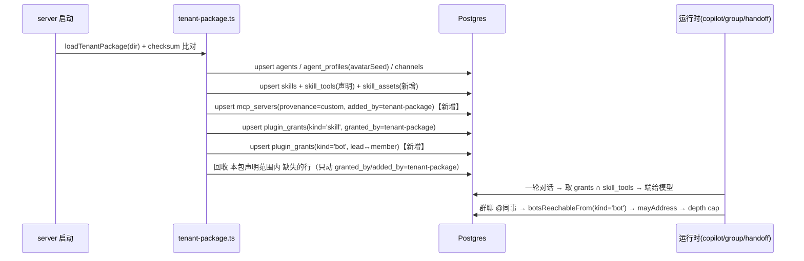

# WorkBuddy 能力资源 → 熊宝数字员工（openbot）移植方案

- 日期：2026-11-12
- 作者：高见远（Architect，software-company 专家团）
- 汇编与事实核验：齐活林（Delivery Director）
- 状态：**待用户确认，未执行，本轮未改动任何源码**
- 目标仓库：`canquedehuiyi-cpu/xiongbaowork`（本地克隆 `xiongbaowork/`，分支 `codex/recovered-source-20261018`）
- 需求原话：「把 workbuddy 上的 专家/专家团、技能/技能包、连接器 直接完整移植到该项目的能力资源中」

## 主理人核验记录（对方案承重假设的独立复核）

方案里三个"可行性依赖"，我在本地逐条跑过，结论如下：

| 方案依赖 | 核验方式 | 结论 |
|---|---|---|
| catalogue 里已有"本地 builtin server"先例，故 `skills/read` 不是新发明 | `grep "kind: \"builtin\"" server/src/plugins/catalogue.ts` | ✅ 成立。`catalogue.ts:306` 的 `routines` 条目，`host: builtin://routines`、`transport: builtin-routines` |
| 群聊 `@同事` 的授权判定确有 `botsReachableFrom` | `grep -rn botsReachableFrom server/src` | ✅ 成立。`agents/handoff-tool.ts:347` 定义、`:404` 作为 `mayAddress` 判据；`index.ts:1600` 注入 |
| 现有品牌包基线是 5 员工 / 5 技能、`product_name` 已是熊宝 | `grep -c` + 读 `brand.yaml` | ✅ 成立。`agents.yaml` 5 条、`skills.yaml` 5 条、`brand.yaml:5 product_name: 熊宝数字员工` |

**一处勘误**：方案 P1 写"新增迁移 `server/drizzle/00XX_skill_assets.sql`"，实际当前最大编号是 `0080_wakerflow_quota_contracts.sql`，新迁移应为 **`0081_skill_assets.sql`**。
>
> **二次勘误（2026-11-12 CI 事故后）**：`drizzle/` 已冻结在 0080，0081–0201 全部位于恢复覆盖层 `server/recovery/recovery-20261018-v1/`（其 journal 必须逐条延续 drizzle journal，见 `server/scripts/migrate.ts` 的 mergedMigrationsFolder）。新增迁移一律**追加到覆盖层**：journal 追加条目（idx 顺延，本次为 idx 202 / tag `0202_skill_assets`）+ SQL 落 `recovery-20261018-v1/sql/`；严禁写 `drizzle/`，否则 CI 全部作业在迁移步骤报 "recovery migration journal does not extend drizzle/meta/_journal.json"。

**一处已核验（原为补漏）**：P0 需在 `openbot/package.json` 注册 `port:capabilities`，否则验收命令跑不起来（方案正文的产出清单原漏了这一项）。**已核验存在**：`"port:capabilities": "bun tools/port-capabilities/index.ts"`（主理人实测）。

---

# 方案正文

## 0. 执行前置：推送通道（必须先解决，否则一切交付无处落地）

| 通道 | 现状（实测） | 判断 |
|---|---|---|
| GitHub `canquedehuiyi-cpu/xiongbaowork` | `gh` 登录账号 `xiongpinji` token 失效；API 返回 403「account was suspended」 | **当前不可用**。不是权限问题，是账号被封，换 PAT 无效 |
| gitee `xiongpinji/xiongbaowork.git` | 本地 `origin` 指向它，工作区干净 | **当前唯一可用通道** |

**结论**：所有阶段交付默认推 `origin`（gitee），分支命名沿用现有习惯 `feat/capability-port-<phase>`。GitHub 侧等账号恢复或改用新 org 后再做一次镜像推送，方案里不假设 `gh` 可用。这一条不是技术风险，是**排期风险**——需要开工前拍一次。

---

## 1. TL;DR 与规模判断

**结论**：能移植，而且落点出奇地顺——"专家/专家团/技能/连接器"四类资产，在 openbot 里都能找到天然载体（`agents/` + `channels` + `plugin_grants(kind='bot')` + `skills` + `mcp_servers`）。真正的成本**不在搬文件，在三处契约缺口和一层工具名语义落差**：WorkBuddy 技能正文写的是 `Read/Bash/Grep/WebFetch/Task`，而 openbot 员工手上只有 12 个 `computer_*` 工具，**没有本地 shell**。因此"移植成功"必须重新定义，否则会得到一堆"文件在、点了没反应"的技能。

**"完整移植"在工程上指**：

| 指 | 不指 |
|---|---|
| 每个 WorkBuddy 概念在目标系统里有**唯一且有语义的载体**（见 §3 映射表） | WorkBuddy 运行时语义等价（本地 shell、`Read` 门禁、`scripts/` 可执行、hooks） |
| L0 全部内容**可被发现**（员工列表 / `/` 菜单 / 连接器页）、**可被授予**、**可被调用** | 把 428 专家 + 293 技能 + 298 连接器的原始目录（约 74MB+）逐字节塞进 git |
| 专家团具备**可运行的多员工协作**（lead 在群里 `@` 成员，受 grant 约束、受 depth/fan-out cap 约束） | 把 WorkBuddy 侧的凭证、授权状态、会话记忆迁过来 |
| 每条内容带**可审计的许可与来源字段**（§6） | 保证 100% 技能"移植后行为一致"——做不到，且必须显式标记降级 |

**工作量量级**（单人，含自测）：

| 档位 | 内容 | 交付到"可运行" | 主要成本构成 |
|---|---|---|---|
| **L0** | 9 专家包（→23 个 agent + 3 个团）+ 60 技能（含 17 个包内技能）+ 3 连接器 | **13–18 人日** | 契约扩展 3 处（40%）、工具映射层与审计（25%）、内容转换与去重（20%）、`skill_assets` 与分页读取（10%）、e2e（5%）。较初稿 9–14 上调三次：技能 42→60（+2）、`skills/read` 分页 + `skills/grep`（+1.5）、`--census`（+0.5，实际排在 P1 第一项，计入总量） |
| **L1 增量** | 428 专家 + 293 官方技能 + 298 连接器定义 | **+8–12 人日** | 抓取管道 + 许可审查（60%）、抽查可跑性（40%）；**搬运本身接近 0** |
| **L2** | SkillHub 15 万+ | **不可批量交付** | 只能做"按需安装"通道，见 §2 |

推荐：**先做 L0 全链路打通（含三处契约扩展），L1 只做"可安装通道 + 白名单"，L2 明确不做。**

---

## 2. 移植分层

### 2.1 三档范围

| | L0 本机已装 | L1 官方全市场 | L2 社区 SkillHub |
|---|---|---|---|
| 专家 | 9 包 → **23 个 agent**（3 lead + 15 member + 5 独立，去重 1 个重复包） | 428 包 → 估 1000+ agent | 无权威计数 |
| 技能 | **60 个**（用户级 43 + 专家包内置 17，见下方对账） | 293 官方技能（`skill-marketplace.zip` ≈30MB） | 15 万+ |
| 连接器 | **3 个**已授权（github / tapd / tencent-docs） | 298 个定义（63MB），**三档**：**227 可声明且凭据可自备**（含 156 条认证方式未声明，需逐个核实）/ **12 端点存在但凭据平台代持**（用户自带 token 即启用）/ **59 无远程端点**（44 个目录无 `mcp.json` + 15 条 `command` 形态，结构性不可移植）；能全自动接通的只有 5 条 oauth（见 §4a-2、§4a-3） | — |
| 入仓体积 | ≈2–3MB 正文 | **禁止入仓**（见 §6） | 禁止 |
| 许可风险 | 中（市场包再分发权未明示） | 高（同 L0 且规模大） | 高 |
| 成本 | **13–18 人日** | +8–12 人日 | 无法估 |
| 推荐 | ✅ 做 | ⚠️ 只做通道 + 白名单 | ❌ 不做批量 |

**技能数 60 的对账（2026-11-12 实测修正，原方案写 42 是错的）**：

| 来源 | 数量 | 说明 |
|---|---|---|
| 用户级技能目录 | 43 | `~/.workbuddy/skills` 下 44 项，其中 `_bm_skillid_migration.json` 是文件不是技能 |
| 专家包内置技能 | 19 | 9 个 `plugin.json` 的 `skills[]` 声明合计 |
| 减：整包重复 | −1 | `ex_eqoqYRT1NIwb` 与 `engineering-workflow-skills` 同 name+version，按 checksum 去重 |
| 减：内容重复 | −1 | `senior-developer/browser-use` 与 `frontend-developer/browser-use` 逐字节相同 |
| **合计** | **60** | 43 + 17 |

原方案写 42 有两处错误：把技能目录数当成 44（实为 43），且**整个漏掉了 17 个专家包内置技能**——而 `agents.yaml` 的 `skills[]` 有 17 处引用它们，漏掉就等于 17 个悬空授权。用户已拍板"三个 `dev-expert` 全部保留、slug 加来源后缀"，故不做合并，43 条全留。

### 2.2 L1 的正确做法：不搬内容，搬"可安装通道"

`skill-marketplace.zip` 与专家 COS bundle 是**部署时抓取物**，不是源码。方案：

1. 新增 `openbot/scripts/fetch-capabilities.ts`：从官方 URL 下载 → 解压到 `openbot/.cache/capabilities/`（**`.gitignore`**）→ 计算每包 sha256 → 写 `openbot/capability-lock.yaml`（**入仓**）。
2. 转换器（§7 P0）从 `.cache/` 读，不直接读 `~/.workbuddy/`；好处：CI 可复现，且不依赖某个人机器的目录布局。
3. 只有 `capability-lock.yaml` 里 `redistributable: true` 且过了 `--only=<whitelist>` 的条目才进品牌包。

这条设计的意义：**L1 的"完整性"由锁文件表达，不由 git 内容表达**。评审时看锁文件（几百行）而不是看 293 个目录。

---

## 3. 落点映射表

一次启动写入链路（整个方案的骨架）：



### 3.1 逐概念映射

| # | WorkBuddy 概念 | openbot 载体 | 判定 | 要点 |
|---|---|---|---|---|
| 1 | 专家（`expertType: 'agent'`） | `agents.yaml` 条目 + `agent_profiles.avatarSeed` | **需转换** | `agents/*.md` 正文 → `system_prompt`；`displayName.zh`→`name`，`profession.zh`→`title`，`displayDescription.zh`→`role_description`；`type: built-in` |
| 2 | 专家团（`expertType: 'team'`） | lead/member 各一个 agent **＋ 新增 `teams.yaml`** → 物化为 `channels` + `plugin_grants(kind='bot')` 双向 | **需扩展契约** | 见 §4b。团队语义没有结构化表，落三处：channel 成员、bot grant（决定能不能 `@`）、lead prompt 的"团队段" |
| 3 | `members[].role` | lead 的 `system_prompt` 追加一段 + `teams.yaml` 的 `role`（仅声明，不建表） | **需转换** | 注意：`responsibilities` 表**不是**这个——它是带 trigger/run 的定时职责，语义不同 |
| 4 | 技能（`skills/<name>/SKILL.md`） | `skills.yaml` 条目 | **需转换** | frontmatter `name`→`slug`（归一化见 §3.2），`description`→`summary`（压成一行），`description_zh` 优先；正文→`instructions` |
| 5 | 技能包（包内自带 skills） | 同 #4，额外记 `skill → source package` 于 manifest | **直接映射** | 包内技能与用户级技能统一进同一 `skills.yaml`；绑定发生在 `agents.yaml` 的 `skills[]`。**以 `plugin.json` 的 `skills[]` 声明为准**：目录里存在但未被声明的技能不移植（`code-architect-expert/skills/architecture-reference` 就是这种，移植它等于给员工发一个作者故意没绑的技能） |
| 6 | 连接器（`mcp.json` 的 `mcpServers.<id>`） | **新增 `connectors.yaml`** → `mcp_servers`（`provenance='custom'`） | **需扩展契约** | 见 §4a。`<id>` 直接作为 `serverId`（工具 ref 前缀） |
| 7 | 连接器附带的 `skill/SKILL.md` | **无载体，不移植** | **不可移植** | 实测全市场只有 1 个连接器带 `skill/` 目录（`github`），且该文件通篇是"先安装连接器再用"的说明——openbot 侧连接器由 `connectors.yaml` 声明即可用，整篇没有可移植内容。记入该 connector 的 `dropped` |
| 8 | 头像（`avatars/*.png`） | `agent_profiles.avatarSeed` | **不可移植（图片）** | 图片不进库；`avatarSeed = slug` 保持稳定唯一；要真图走部署侧挂载 |
| 9 | 技能多文件附件（`references/` `templates/`） | `skill_assets`（新增表）+ 内置工具 `skills/read` | **需扩展契约** | 见 §4c |
| 10 | 技能 `scripts/`（`.py`/`.sh`） | **无载体** | **不可移植** | 无 shell、无 Python；manifest 标 `scripts: dropped`，正文改写成"本环境不可执行" |
| 11 | `allowed-tools` frontmatter | `skill_tools` 声明（`<serverId>/<toolName>`） | **需转换** | 过 §5 映射层；无法映射的**丢弃并记 manifest**，不留悬空 ref |
| 12 | 专家 `skills[]` | `agents.yaml` 的 `skills[]` → `plugin_grants(kind='skill')` | **直接映射** | 已支持，`granted_by='tenant-package'` |
| 13 | 群聊里 lead `@` 成员 | `channels` + `plugin_grants(kind='bot')`；`botsReachableFrom` 读 kind='bot'；`agents/handoff.ts` 的 depth cap / fan-out cap 已存在 | **直接映射（授权侧需扩契约）** | **不写 bot grant 就 `@` 不动**，这是最容易漏的一步 |
| 14 | `plugin.json` 元数据 | `capability-manifest.yaml`（新增） | **需转换** | 来源、版本、许可、checksum 全在这（§6.4） |

### 3.2 命名归一（必须先做，否则导入即冲突）

事实：`skills.slug` 有全局唯一索引（`skills_slug_key`）。而 WorkBuddy 侧实存重名：`dev-expert` 三个来源版本 + `dev-expert-pro` + `dev-god`。

规则：
- `slug = kebab(sourceName)`；冲突时追加来源后缀：`dev-expert__skillhub`、`dev-expert--indiv-weishui`。
- 同一 `name+version` 的重复下载（`ex_eqoqYRT1NIwb` vs `engineering-workflow-skills`）→ **按 checksum 去重，保留可读的目录名**。
- 冲突不是错误，但要产出 `docs/porting/slug-conflicts.md` 让人过一遍，避免"两个 dev-expert 谁被谁覆盖"这种无声事故。
- **跨包冲突时裸名必须给用户级**：同一个 `fullstack-dev` 既是专家包自带技能又是用户级独立技能、且两者内容不同时，裸 slug 给用户级那份，包内那份加包名后缀。禁止"包内那份抢到裸名"——它会让用户 `/fullstack-dev` 调到一份自己没见过的指令，界面上看不出来。

---

## 4. 三处契约缺口的处置

### 4a. 品牌包不能声明连接器

**路径 A1：扩契约，新增 `connectors.yaml`（推荐终态）**

```yaml
connectors:
  - id: github            # 同时是 serverId，也是工具 ref 的前缀
    title: GitHub
    vendor: GitHub
    url: https://api.githubcopilot.com/mcp/
    host: api.githubcopilot.com   # 必须与 url 的 host 逐字符相等，否则拒绝加载
    auth: user-oauth              # deployment-bearer | user-oauth | none
    credential_env: GITHUB_MCP_CREDENTIAL_ID   # 只声明变量名，绝不写值
    docs_url: https://...
    write_tools: [create_pull_request, merge_pull_request]
```

- 同步：写 `mcp_servers(provenance='custom', added_by='tenant-package', catalogue_key=null)`；`credentialId` 留空，启动时若 `credential_env` 命中的凭据行存在才绑定，否则"能力与资源"页显示"待绑定"。
- 回收：只删 `added_by='tenant-package'` 且本包声明集合之外的 id；`mcp_tools` 已有 `onDelete: cascade`；同时清 `plugin_grants`/`skill_tools` 里指向该 server 的 ref。
- 风险面：包的 url 由包作者决定 → 用 `host` 锚定（与 `CatalogueEntry.host` 同等审查强度）+ **永不自动绑定凭证**（`mcp_servers.credentialId` 的 FK 是 `restrict`，这里刻意留 null）。
- 成本：`tenant-package.ts` +250~350 行、1 个测试文件、0 迁移。

**路径 A2：不动契约，一次性脚本（零侵入）**

`openbot/scripts/bootstrap-connectors.ts` 调已有的 `pluginStore.addCustomServer()`（`plugins/store.ts:2818`）把 3 个连接器写进库。
- 优点：今天就能通，零契约风险，1 人日。
- 缺点：不可复现（换机/新租户要重跑）、不在 checksum 保护内、"能力与资源"页看不到归属。

**推荐：A2 → A1，分两步**。P2 先用 A2 打通 3 个连接器并验证工具可被 grant；P1 做完 A1 后把 A2 降级为"无包环境下的兼容入口"。

#### 4a-2 认证方式不能从 `mcp.json` 推导（L1 的硬约束）

上面 `connectors.yaml` 的 `auth: user-oauth | deployment-bearer | none` 看起来是转换器"看一眼就能填"的，实际填不出来。`mcp.json` 是**上游厂商的公开形态**，不是认证明细；WorkBuddy 自己的凭证注入是平台级的一次性请求期 header 改写（`connectors.json` 顶层的 `auth_injection_rules`，形如 `{"from_connector":"tencent-docs","token_type":"mcp-oauth","inject":[{"header":"Authorization","value_template":"Bearer ${access_token}"}]}`），这套东西依赖它自己的 token 代理，**在 openbot 侧不存在**。

实测 298 个连接器（2026-11-12 本机统计，主理人已独立复现，口径逐条一致）：

```
298 个目录
  ├─ 239 个有远程 url   （https 237 / http 1 / 无 scheme 1；无 localhost）
  ├─  15 个 stdio command
  └─  44 个没有 mcp.json（正好等于 connectors.json 里 type=cli 的 44 个）
```

`auth_mode` 分布——**分母是 239（有远程端点的那些），不是 298**：

| `auth_mode` | 条数 | 占 239 | 能否映射到 openbot 的凭证模型 |
|---|---|---|---|
| 未声明（字段缺失） | **156** | 65% | **不能默认当成"不需要凭证"**——缺字段只说明上游没说，首次调用就会失败 |
| `token` | **64** | 27% | 能，但需用户提供 token 值；header 名与值模板要逐条填 |
| `server-side` | **12** | 5% | **凭证在厂商侧代持**，openbot 无对应形态；用户自带 token 可绕过，视厂商是否允许 |
| `oauth` | **5** | 2% | 可映射 `user-oauth`，需逐条填 authorization/token URL |
| `oneid-token` / `mcp` | 1 + 1 | — | 需人工判断 |

> **上一版这张表的分母是错的**：我当时写成"未声明 210 / token 69"，把 44 个**根本没有 `mcp.json`** 的目录也算进了"未声明"。分母一错，"未声明占大多数"就说不清是哪部分的大多数——我拿它当 298 的 70% 讲，实际它是 239 的 65%，而这 65% 里每一条都还有远程端点、都还有救。这个错比对错更坏：它把一批可移植的东西算进了不可移植。

#### 4a-3 三档，不是两档（两档会把处置相反的事并进一个桶）

| 档 | 条数 | 构成 | 性质 | 处置 |
|---|---|---|---|---|
| **A 端点存在 + 凭据可自备** | **227** | 156 未声明 + 64 `token` + 5 `oauth` + 1 `oneid-token` + 1 `mcp` | 可声明、可绑定 | `connectors.yaml` 声明 + UI 逐条绑定；其中 156 条先标 `auth-undeclared` |
| **B 端点存在 + 凭据平台代持** | **12** | `server-side` | **可移植但需要用户带钥匙** | 与 L0 里 `github` 降级成 `user-oauth` **完全同构**，同一个处理我们已经做过一次 |
| **C 无远程端点** | **59** | 44 无 `mcp.json` + 15 `stdio` | **真的结构性不可移植** | 丢弃这 59 条，等对方出远程版；记入 `dropped` 并写明原因 |

校验：227 + 12 + 59 = 298；且 227 + 12 = 239（有远程 url 的全体），59 = 44 + 15（无端点全体）。

**与 `--census` 产物的对齐（两个口径都对，别让下一个人以为 227 与 238 冲突）**：census 在 `f7337198` 上给出 `verdict: full 238 / degraded 1 / blocked 59`。映射关系：

| census verdict | 本表三档 | 差值解释 |
|---|---|---|
| full **238** | A 227 + B 12 − degraded 1 | census 把 B 档（`server-side`）算 **full**——它"能声明、能连、只需用户带钥匙"，这个口径与本表一致 |
| degraded **1** | 落在 A/B 之间 | 唯一一条 `auth_mode: "mcp"`，凭据模型无法自动映射，标 `unknown` |
| blocked **59** | C 59 | 完全一致 |

**两边必须给同一个分母**：census 的 `auth_mode_raw` 是 **298 基数**（每个目录都有这个字段），本表 §4a-2 是 **239 基数**（只算有远程端点的）。两者差的 54 条 `(absent)` + 5 条 `token`，正好是那 59 条无 `mcp-url` 的条目。**上一版我就是栽在分母上**，这次提前写明，免得再被算一次。

**为什么必须拆**：把 B 和 C 合成"72 条不可移植"，读者会得出"这 72 个彻底没戏"，而**其中 12 个只要我们要求用户填一次凭据就能用**。两档表述的错不在于数字，在于**它把处置方式相反的两件事写成了一件事**——C 该丢，B 该催用户绑。

结论（请以此为准）：
1. **凭证形态是两件事，不能合成一句**：`token`（64 条）是"用户提供值即可用"，是**能带过去的**；`server-side`（12 条）是"厂商代持、openbot 无对应形态"，**用户自带 token 可绕过，视厂商是否允许**。上一版把这两类合写成"81 条带不过去"，等于把 64 条能用的算成废的。
2. 两者都不能从 `mcp.json` 自动推导 header 名与值模板，所以：`connectors.yaml` 只写 `url / host / vendor / title`，`auth` 一律先落 `unknown`，`credential_env` 留空；管理员在"能力与资源"页逐条绑定。**不要把"能声明"误当成"能认证"。**
3. **156 条认证方式未声明必须单列，不能默默算进"能用"**——它是 239 的 65%，首次调用就会失败。census 标 `auth-undeclared`，报告里单独一段，UI 上单独一个徽章。
4. 对外承诺改成三档：**80%（239/298）有远程端点**，其中 12 条需用户自带凭据、156 条认证方式待逐个核实；**真正能按 `user-oauth` 全自动接通的只有 5 条**。**"24% 不可移植"这个说法废弃**——它把 B、C 两档并了，而 B 档是"催用户绑一次就能用"，不是"没戏"。

#### 4a-4 `--census` 的 `reason code`（现在定死，否则 census 写完要返工）

每条 entry **必须同时有 `verdict`（能不能声明）与 `reason`（为什么）**。只给 verdict 的数没法指导排期——同一个 `dropped` 里可能装着"永远没戏"和"催一次就好"两种病。

| 字段 | 取值 | 说明 |
|---|---|---|
| `directory` | 相对路径 | 稳定标识，不用名字（会重名） |
| `transport` | `remote` \| `stdio` \| `none` | `none` = 目录里没有 `mcp.json` |
| `auth_mode_raw` | 原始值；缺失写 **`<missing>`** | **不许写 `null`**——`null` 会被下游读成"不需要认证" |
| `auth_mapped` | `user-oauth` \| `deployment-bearer` \| `unknown` \| `none` | 推导不出的写 `unknown`，不猜 |
| `verdict` | `declarable` \| `dropped` | 只回答"能不能写进 `connectors.yaml`" |
| `reason` | 见下表四值 | 与 `verdict` 组合后唯一确定处置动作 |

| `reason` | `verdict` | 命中条件 | 条数（手算，待 census 核实） | 处置动作 |
|---|---|---|---|---|
| `no-remote-endpoint` | `dropped` | `transport ∈ {stdio, none}` | **59** | 丢弃，记入 `dropped` 并写原因 |
| `platform-held-credential` | **`declarable`** | `auth_mode_raw == server-side` | **12** | 声明 + 催用户自带 token |
| `auth-undeclared` | **`declarable`** | `auth_mode_raw == <missing>` | **156** | 声明 + 逐个核实认证方式 |
| `ok` | `declarable` | 其余（`token`/`oauth`/`oneid-token`/`mcp`） | **71** | 声明 + 逐条填 header/URL |

**汇总输出的硬约束**：`counts` 里必须给**三档 + 未声明单列**，**禁止只输出"可声明 X / 不可移植 Y"两个数**。两数格式是可复用性最强的错——它一定会在下一个人手里重新把 B 档算进不可移植。同理，`auth-undeclared` 的条数要独立成字段，不能混进 `ok`。


### 4b. 品牌包不能声明专家团/群组编排

**路径 B1：零 schema，`teams.yaml` → channel + bot grant + prompt（推荐）**

```yaml
teams:
  - id: software-company
    name: 软件公司
    description: 一个 lead 带四个成员，按需把活交出去
    channel: software-company
    lead: software-company-lead
    members:
      - id: software-company-pm
        role: 产品经理    # 只进 teams.yaml 与 lead 的 prompt，不建表
    address:            # 谁可以 @ 谁，物化为 plugin_grants(kind='bot')
      - from: software-company-lead
        to: [software-company-pm, software-company-engineer, software-company-architect, software-company-qa]
```

- 物化三件事：① `channels`（`permitted_agents` = 全团）；② `plugin_grants(kind='bot')`——`mayAddress` 的唯一依据；③ lead 的 `system_prompt` 追加"你的团队 + 交接规则"段。
- 优点：**0 迁移、0 新表**，完全复用既有 `botsReachableFrom` / depth cap / fan-out cap / 群消息 thread 机制。
- 缺点：没有"组织结构"数据；成员仍独立出现在员工列表（**不能"藏在团里"**）；跨团 `@` 必须显式声明 grant。

**路径 B2：新表 `agent_teams` + `agent_team_members` + UI**
- 缺点：与 `channels` + `plugin_grants` **同一事实写两处**——本仓库反复强调的反模式（见 `mcp_servers.provenance` 与 `url` 的 "ONE FACT IN TWO PLACES" 注释）；两表 + 迁移 + 两个页面 ≈ 5–7 人日，收益只有"UI 里能编辑"。

**推荐 B1**。B2 等到"用户要在 UI 里改团队"这个需求真的出现再做。

### 4c. 技能不支持多文件附件（渐进式披露）

WorkBuddy 技能的核心机制是"SKILL.md 入口 + 按步 `Read` references"（`dev-expert` 明写"未读 = 该步门禁未生效"）。目标系统 `skills.instructions` 是**单段 text**。

**路径 C1：内联压平** — `references/` 拼到 `instructions` 尾部附录。
- 优点：0 改动，今天可跑。
- 缺点：渐进式披露消失；正文 4KB → 20–60KB。
- **成本口径修正（P0 实测后）**：`skills.instructions` 不是每轮都插——只有该技能被 `/slug` 调用时才前插本轮，参与工具筛选的是 `summary`（一行）。所以 C1 的代价是"调用那一次多十几 KB 上下文"，不是"每轮翻十倍"。P0 实测 60 条 instructions 合计 806KB、均值 13.4KB。真正的风险只在**少数超长技能**（20–60KB）一次吃掉大半上下文预算——这正是 C2 只对超额条目启用的理由。

**路径 C2：`skill_assets` + 内置读工具（推荐终态）**
- 新表 `skill_assets(tenantId, skillId, path, mediaType, content, bytes, checksum)`，PK `(skillId, path)`，`onDelete: cascade`。
- 新内置 server `skills`，工具 `skills/list` / `skills/read`，ref 形如 `skills/read`。**先例已核验存在**：`catalogue.ts:306` 的 `routines` 是 `host: builtin://routines` 的 builtin 条目。
- 运行时：`instructions` 尾部追加机器生成的附件清单（`- references/step-3.md（8.2KB）：第三步细则，执行前必须读完`）。
- 校验：`skills/read` 只允许读**调用者已获 grant 的技能**的附件，越权直接 refuse（必须单测）。
- 成本：1 张表 + 1 迁移 + 1 个工具 + 授权面 + 回收逻辑，≈4–5 人日。

**推荐：双轨制，阈值 24KB**。≤24KB 走 C1 内联；>24KB 走 C2（`dev-expert`、`frontend-developer`、`humanize-ppt-team` 的技能大概率在这档）。**阈值必须写进 manifest**，否则半年后没人知道为什么有的技能能 `Read` 有的不能。

---

## 5. 工具名映射层

### 5.1 事实对照

| WorkBuddy 正文里的写法 | openbot 现状 | 等价度 |
|---|---|---|
| `Read(path)` | `computer_read_file` | 部分（无工作区/行号语义） |
| `Write(path)` / `Edit(path, old, new)` | `computer_write_file` | 部分（**无 diff/patch**） |
| `Glob(pattern)` | `computer_list_files` | 部分 |
| `Grep(pattern, path)` | **无** | 需 shim |
| `Bash(cmd)` | **无 shell、无 Python、无 Node** | **不可等价** |
| `WebFetch(url)` | `computer_navigate` + `computer_read` | 部分 |
| `Task(subagent)` | 无子代理；对应物是 handoff（`@同事`） | 语义不同（异步、需授权、有深度上限） |
| `Skill(slug)` | `/slug` 技能本身 | 直接 |
| `mcp__<server>__<tool>` | `<serverId>/<toolName>` | 直接 |

补充约束：`SELECTION_FLOOR = 12`（`plugins/selection.ts:82`）——工具数 ≤12 时不筛选，全给。多数员工授权工具数低于 12，意味着**技能声明的 `tools` 在 L0 阶段基本不起作用**；不要指望"声明式收窄"救 token，收窄要靠 §4c 的附件设计。

### 5.2 策略：改写为主，shim 为辅，语义落差如实标注

1. **改写（必做）**：`tools/port-capabilities/rewrite-toolrefs.ts`，一张映射表 + 正文首部插入"环境事实"段：
   > 本环境没有 shell，也没有 `Bash`；文件读写只有 `computer_read_file` / `computer_write_file`（作用于你自己的电脑，不是服务端容器）。需要真正执行命令时，不要伪造结果——把这一步交给"在我电脑上跑"。
2. **shim（只做两个）**：
   - `skills/read`（§4c）—— 唯一必须；
   - `fs/grep` **不做**。它需要落到"谁的机器"上，而设备通道已有"在我电脑上跑"这条正路。语义半吊子的 grep 只会让模型误以为自己在 Linux 上。
3. **不可等价的部分（Bash / Task / 可执行 scripts）**——不 shim，改写成"降级说明"，manifest 打标。诚实降级好过假装能跑。

### 5.3 自动检测"移植后不可执行"的技能清单（必交付物）

`tools/port-capabilities/audit-toolrefs.ts` 静态扫描每条 `instructions`：

| 规则（正则族） | 判定 |
|---|---|
| `/\b(Read|Write|Edit|MultiEdit|Glob|Grep|WebFetch)\(/` | 命中→查映射表，缺映射则 `degraded` |
| `shell-tool-call`：`/\b(Bash|Shell|Terminal)\s*\(/` | `blocked`（括号形态即真调用，不看实参） |
| `shell-command-prose`：命令词（`bash|sh|zsh|python|python3|node|npm|pnpm|yarn|deno|bun|pwsh|powershell|cmd`）**且**含 shell 特征任一 → heredoc `<<-?\s*['"]?\w+` / flag `(?<=\s)-{1,2}[A-Za-z]` / 路径型实参 `\s\S*/\S*` 或 `\s\S*\.\w{1,5}` / 管道重定向 `\|\|`、`&&`、`$(`、`>`| `blocked` |
| `/mcp__([\w-]+)__([\w-]+)/` | `serverId` 不在 `connectors.yaml` → `blocked` |
| `/\bTask\(/` | `degraded` |
| 引用 `scripts/` 下文件 | `blocked` |
| 引用 `references/` 且未走 C2 | `degraded` |

产出 `docs/porting/tool-ref-audit.md`：每个技能一行 → `slug / runnable(full|degraded|blocked) / 命中引用 / 原因 / 建议`。**这张表是"到底移植成功了百分之几"的唯一可信答案**，不要用文件数汇报。CI 里作非阻断检查。

> 主理人补充的量化基线：我扫了本机 44 个技能的 `SKILL.md` 正文，**20 个**命中 `Bash`/`Read`/`Write`/`Grep`/`mcp__` 引用（含 dev-expert 全系 4 个变体、agent-team-orchestration、hash-bound-review-loop、hostile-git-repo-recovery、windows-pc-tuneup 等），**24 个**为纯指令型。这条基线可与审计器的输出对账。

**围栏规则（P0 实测补充，必须照此实现）**：```bash 代码围栏本身不算"执行命令"——很多技能只是用它排版。命中与否由规则 A（括号调用）与规则 B（命令词 + shell 特征）决定，**围栏不构成 shell 特征**。若把围栏也算命中，会多误判 8 个仅用围栏排版的技能。**但围栏内部若出现规则 A/B 的形态（如 `python3 <<'EOF'`），仍判 `blocked`**。

**为什么必须拆成两条（P0 第二轮修正）**：一条正则同时承担"识别调用形态"与"识别散文提及"两件事，`\w` 会让任何后随单词都算实参，于是 `bash commands`、`node junction` 这类散文被误判成命令。拆开后规则 A 只认括号形态，规则 B 要求 shell 特征；`python - <<'EOF'` 与 `python3 <<'EOF'`（无 `-`）都必须命中，`Do NOT run bash commands…` 与 `node junction` 都必须不命中。

**已知限制必须登记，且假阳性/假阴性两边都要写**（只写一边叫"未知"，不叫"已知"）。下面两条是 P0 定稿时全部已知的偏差，**任何一条新增都必须进这张表**：

| 方向 | 例子 | 取舍 |
|---|---|---|
| 已接受**假阳性** | `Bash (shell)`（半角括号 + 空格）判为 blocked | 接受。放宽会连带丢掉 `Bash(npm install)` 这个真调用。原则：半角括号形态一律当调用；中文散文用全角 `（`，天然不命中 |
| 已接受**假阴性** | 单竖线散文 `` `cat f \| grep x` `` 不命中 | 接受。单 `\|` 在 Markdown 表格里远比 shell 管道常见；`\|\|`、`&&`、`$(` 仍匹配，括号形态由规则 A 兜底 |

**这两条都必须有单测钉住，注释不算**。QA 实测：`Bash (shell)` 这条"已接受假阳性"目前只有代码注释、没有断言——意味着将来有人"顺手修掉这个误报"时，没有任何红灯拦他。已接受 ≠ 已固定；**没有测试的"已接受"，只是还没被人推翻的临时状态**。

> **上一版第 3、4 行已删除**，因为两条都不再成立：第 3 行说"只依赖 `git`/`docker`/`kubectl`/`ssh` 的技能会被判 full"——词表已扩（§5.4），这条债已还；第 4 行说"否定护栏不覆盖规则 A"——护栏已撤回（§8 G3 末），那条假阳性不再使用该机制描述。

**P0 实测分档（本轮结论数字，全文以这一组为准）**：

| 对象 | full | degraded | blocked | 合计 |
|---|---|---|---|---|
| 60 条技能 | **26** | 0 | **34** | 60（可执行率 **43%**） |
| 23 个 agent | **21** | 1 | **1** | 23 |

> **26/34 是 `f7337198` 上的实测值（含词表扩展），但它还不是终值**：①`hash-bound-review-loop` 已核全文，**判对**（`:54`/`:56` 是祈使 + flag），不回 full；②**`path-shaped` 分支零触发（G2 缺陷）修好之后，数字必再动一次**。所以这一组数的定位是"规则未冻结前的过程观察"。
> **数字冻结纪律**：规则（含词表、四类特征、`SEVERITY_ORDER`）**冻结之前不对外发布任何终值**；冻结后再跑一次全量审计，那一组才是终稿。**这已经是第 4 次数字变动（34/26 → 31/29 → 26/34 → 待定），每一次都是审计变准，没有一次是能力变化。**
> **32/28 这个靶子已作废**（2026-11-12 撤回）。它建立在"`frontend-artifact-contract-drift-triage` 应回 full"这个错误判断上——那条技能 65–68 行有真 `scp`/`ssh` 探针命令，blocked 本来就对（详见翻转表）。**任何地方再出现"待修为 32/28"都是我们自己的旧账，不成立。**

> **agent 与 team 的变动口径**：agent 从 20/1/2 到 21/1/1 的全部变动是**一条**（`software-engineer`，否定语境），没有白名单（`grep` 全仓 0 命中）。**团队（`team software-company`）也从 blocked 变 full，但那是成员档位的推导结果，不计作独立变动、不进 agent 的翻转计数**——团队没有自己的探测规则，它的档位等于成员的最差值。任何报告里若把 team 变化算成"第 2 条 agent 翻转"，就是重复计数。

**技能从 34/0/26 起的八条翻转（逐条给原文；5 条待逐条举证）**：

| slug | 改前 → 改后 | 命中原文 / 全文核对 | 性质 |
|---|---|---|---|
| `video-content-forensics` | full → blocked | `:41` `# 首次：cd …/workspace && npm i playwright && npx playwright install chromium` | **① 判对：旧规则假阴性**（旧词表只有 `bash\|sh\|python\|node`，没有 `npm`） |
| `hostile-git-repo-recovery` | full → blocked | 一度只引 `:108` 散文；全文核对后 `:34` `git init -q t && git commit …`、`:110` `git bundle create "$BK/repo-all.bundle" --all`、`:130` `git commit -F - <<'EOF'` 等 20+ 处真命令 | **① 判对**（结论一直对）。词表扩 `git` 后由**规则真正命中**，不再依赖散文——R19 的债由此还清，引文按质量排序换成命令行 |
| `frontend-artifact-contract-drift-triage` | full → blocked，**保持 blocked** | 报告引的是 `:84` 禁止句 ``1. **不要用 `ssh host 'node -e "..."'` 做关键判定。**``；但全文 `:65–68` 有 ```scp -i key.pem probe.js …``` / ```ssh -i key.pem … node /tmp/probe.js```，`:86` 明写「**一律写 `.js` 文件 scp 上去跑**」 | **① 判对、引错**。这是它推荐的生产环境探针路径，**真依赖**。上一版判它"否定语境误报、应回 full"是**我们三个角色一起判错**，见下方方法论 |
| `frontend-developer--fullstack-dev` | full → blocked | 待举证 | **待逐条举证**（新增，词表扩 `git` 等引起） |
| `fullstack-dev` | full → blocked | 待举证 | 待逐条举证 |
| `hash-bound-review-loop` | full → blocked，**保持 blocked** | 报告引的是 `:15`（警告句）；但全文核过，`:54`「**冻结**：算出两个产物的 sha256、字节数、行数、`git hash-object` blob、`git diff --numstat`。」与 `:56`「全量验证：… → `git diff --check` → …」都是**祈使**且带 flag | **① 判对、引错**。主理人与 QA 都曾据 `:15` 疑为假阳性，**两人都只读了那一行**——这条正好是"举证必须核全文"的第一个战果 |
| `remotion-video-toolkit` | full → blocked | 待举证 | 待逐条举证 |
| `wiring-and-coverage-audit` | full → blocked | 待举证 | 待逐条举证 |

**这次判错的方法论（比数字重要）**：`frontend-artifact-contract-drift-triage` 是**我、主理人、QA 三方一起判错的**，错法完全一样——**都拿报告里引用的那一行当"唯一命中"的证据，没有人去读全文命中数**。核心问题是：报告本身就是"可能引错了行"的产物，用它的引文去证明它的结论，是把测量工具当成了被测对象。

**所以新增一条硬规则**：任何档位变动的举证，必须给三项——① **全文件命中数**（`grep` 计数）；② **决定档位的那一条命中**（原文 + 行号 + 位置性质：代码块内 / 行首命令 / 散文夹带）；③ 若报告引文与实际决定性命中不是同一条，**必须指出并归入 `weak-citation`**。**只给一条引文的举证，一律不成立。**

`degraded` 为 0 是"被压制"的结果而非不可达：本语料里会命中 `Read(...)`、`Task(...)`、缺附件三条规则的只有 `darwin-skill` 一次，而它同时命中 `scripts/` 被升级成 blocked（严重度取最坏）。**这提示 `degraded` 档在 P3 真正改写正文之前基本不会出现**，它是改写层完成度的标志位，不是 P0 的分布主力；UI 徽章做三态，但文案不得暗示"降级是常见情况"。

> **判据纪律（三次改判后定稿）**：评审时不许用"数字应不应该变"当判据——我先后写过两版错的闸门（"逐条不变"、再"`full→blocked` 一律拒绝"），两次都错在同一处：**把预测或方向当成了真值检验**。真正的判据只有一条：**新的档位是否与实际正文相符**。
> **第三次改判是这条纪律的加强版**：`frontend-artifact-contract-drift-triage` 我们判它"应回 full"时，依据也是"正文"——但只读了正文的**一行**。所以纪律要补一句：**"与实际正文相符"指的是与全文相符，不是与引文相符。** 三个角色用同一条引文互相印证，得到的不是三方独立验证，是同一个错误的三份拷贝。
> **而这轮我在这条纪律上又犯了两回**：①按"提到 `git` 就算命中"估扩表风险，忽略了规则 B 是合取式（合取结构没读全）；②为一条从未发生过的误报设计了一整套豁免护栏（前提没读全）。三次错法不同，同一个根：**在没读全的信息上做架构决策，而且每次都先给出一个自信的因果解释**。所以判据的每一次自洽，都要先问一句：**我读的是全文，还是引文？**

---

### 5.4 命令词表：扩了，但要按举证制核新增的每一条

**结论翻转（2026-11-12）**：上一版这一节写的是"P0 不扩词表"，理由是"`git` 有祈使/描述两种用法，扩了会造大批假阳性"。**这个预测被工程师实测否证了。**

实测（扩 `git|npx|docker|kubectl|ssh`）：

| 结果 | 数 |
|---|---|
| 新增 blocked | **5 条**（`frontend-developer--fullstack-dev`、`fullstack-dev`、`hash-bound-review-loop`、`remotion-video-toolkit`、`wiring-and-coverage-audit`） |
| 大规模假阳性 | **没有出现** |
| 技能分档 | 26 / 0 / 34 |

**我错在哪里（这段比结论重要）**：我建模时把"扩词表"当成了"任何提到 `git` 的地方都会命中"，于是推论出"描述句会成片变 blocked"。实际规则 B 是**合取式**——`命令词` **且** **同一行出现 shell 特征**（flag / 路径型实参 / heredoc / 操作符）。所以：

| 句子 | 有命令词？ | 有 shell 特征？ | 实际结果 |
|---|---|---|---|
| "若 `git status` 显示大批 `D`，说明工作树被删" | 是 | **否**（`status` 不是 flag、无路径、无操作符） | **不命中**——我预判它会命中，这是错的那一半 |
| "依次跑 `git rev-parse HEAD`、`git ls-files \| wc -l`" | 是 | 是（`\|`、`HEAD` 路径型） | 命中 |
| "`git --shortstat` 数字照抄，被审查判为 blocker" | 是 | 是（`--shortstat` 是 flag） | 命中 → **疑似假阳性**，见下 |

**所以"祈使 vs 描述"的判别不是扩词表的前置条件**，它只对少数边界句成立——就是那种"散文里写出带 flag 的引用"的句子。我之前把它当成全局前置，是**把一个局部问题当成了架构级阻塞**。

修正后的决定：

| 决定 | 内容 |
|---|---|
| **P0** | **词表扩到** `bash\|sh\|zsh\|python\|python3\|node\|npm\|pnpm\|yarn\|deno\|bun\|pwsh\|powershell\|cmd\|git\|npx\|docker\|kubectl\|ssh`；新增的 5 条**逐条举证**，只接受"全文命中数 + 决定性命中"两项齐全的举证（§5.3 硬规则） |
| **举证制** | 5 条里凡举不出祈使证据的（疑似 `hash-bound-review-loop`），**回 full**；凡举得出真命令的，保持 blocked。**以举证结论定终值，不以"扩表的预期效果"定终值** |
| **`git` 相关两笔债已还** | `hostile-git-repo-recovery`（靠 `:108` 散文撑着）与 `frontend-artifact-contract-drift-triage`（靠 `:84` 禁止句撑着）都因 `git`/`ssh` 入表而由**规则真正命中真命令**，不再是"结论对、证据虚"——R19 的实质缓解由此达成 |
| **P1** | 第一项是 **`--census`**（见 §7）。它独立、不动这组数字、把 L1 的 **227 / 12 / 59 三档**（外加 156 条 `auth-undeclared`）从手算变成产出，且必须带 `reason code`（§4a-4） |
| **数字** | 26/34 是实测值，1 条待核；**不写"终值"三个字**，等举证结论 |

> **两条教训都要留**：①**排期该看风险、不该看影响面**——我最初把 census 与扩表并列为 P1，依据是"census 不动数字所以可以后做"，错；②**预测风险时要把规则的合取结构算进去**——我按"单词出现即命中"估风险，把一个 5 条的影响估成了成片误判，差点据此否掉一个正确的改动。**高估风险与低估风险，代价都是判断错。**

---

## 6. 数据与许可

### 6.1 什么能入仓

| 内容 | 入仓 | 理由 |
|---|---|---|
| 转换脚本、审计器、抓取器 | ✅ | 我们自己的代码 |
| 生成的 `agents.yaml` / `skills.yaml` / `teams.yaml` / `connectors.yaml` / `capability-manifest.yaml` | ✅ | 转换产物，体积可控 |
| L0 的 `SKILL.md` 正文 + ≤24KB 的 references | ✅（≈2–3MB） | 需评审、需 diff |
| `capability-lock.yaml` | ✅ | 完整性靠锁文件表达 |
| L1/L2 原始正文与 63MB 连接器目录 | ❌ | 见下 |
| `.credentials.v3.json` | ❌ **绝对禁止** | 加密凭证，入仓即事故 |
| `model.yaml` 里的凭证真值 | ❌ | 只允许写变量名 |
| `avatars/*.png` | ⚠️ 默认不入 | 用 `avatar_seed` 派生 |
| `scripts/*.py|*.sh` | ❌ | 不可执行，且许可最杂 |

### 6.2 许可风险与处置

| 资产 | 许可状态 | 处置 |
|---|---|---|
| openbot 源码 | MIT（`Copyright (c) 2026 CopilotKit`） | 保留 `LICENSE` 与版权行；派生作品继续 MIT |
| WorkBuddy 官方技能/专家包 | **再分发权未声明** | 默认 `redistributable: false`，不入 git；部署时抓取 |
| 社区 SkillHub 技能 | 各异（`license` 字段只有 5/44 填了） | 只允许人工逐个确认后进白名单 |
| 第三方连接器 `mcp.json` | 描述性配置，风险低 | 可入仓，每条带 `source_url` |

### 6.3 MIT 与闭源收费的边界

| 允许 | 必须 | 禁止 |
|---|---|---|
| 闭源分发私有修改、按订阅收费 | 分发（含 Docker 镜像）时随附完整 MIT 文本与原版权声明 | 移除/替换 `Copyright (c) 2026 CopilotKit` |
| 新增文件里加 `Copyright (c) 2026 熊宝` 并采用不同许可 | 明确声明"基于 OpenBot（MIT）构建" | 用 `CopilotKit` 商标做产品名/域名 |
| 对衍生整体主张商业条款 | 向取得二进制者提供源码获取方式 | 把上游既有文件改成专有许可 |

一条容易踩的坑：**转换器放进 MIT 仓库，它就是 MIT 的**，竞品可拿去用。若不能接受，转换器必须放独立私有仓库、构建时以 artifact 注入。这是取舍，不是技术问题。

### 6.4 每条必须携带的许可字段（`capability-manifest.yaml`）

```yaml
- kind: skill            # agent|skill|connector|team
  slug: dev-expert
  source: "workbuddy skill-marketplace:dev-expert@2.0.3"
  source_url: https://download.codebuddy.cn/...
  source_version: 2.0.3
  fetched_at: 2026-10-18T00:00:00Z
  checksum_sha256: <64hex>
  license: "proprietary-workbuddy-marketplace"
  redistributable: false
  attribution: "© WorkBuddy"
  runnable: degraded       # full|degraded|blocked
  dropped: ["scripts/", "references/large/**"]
```

**这 9 个字段缺一个，条目不许进包**——在转换器里做硬校验，不靠人记。

#### 6.4.1 `audit_rules_sha256` 的落点（定稿：YAML 注释，不新增伴生文件）

`capability-manifest.yaml` 的根节点**必须是 YAML 序列**（`index.ts` 用 `parseYaml` + `Array.isArray` 校验，加顶层字段会让根变 mapping 而直接挂）。因此版本标识写成**首行注释**：

```yaml
# audit_rules_sha256: <64hex>
# audit_rules_count: <int>
- kind: skill
  ...
```

同一行同时写进 `docs/porting/tool-ref-audit.md` 的头部，两处**必须相等，且两处都必须断言**——两个落点写进去却只校验一个，等于给自己留了个假的完整感。

三条实现约束，缺一条这个字段就白加：

1. **校验必须读原始文本**，不能用 `parseYaml` 的结果——YAML 解析会丢弃注释，任何格式化器也会。`--verify` 的具体动作（定稿 A-1）：**先剥 BOM**（源里已有 BOM 处理先例，别在这栽跟头）→ 正则 `/^# audit_rules_sha256: [0-9a-f]{64}$/` 必须匹配**第一行** → 缺失或不匹配即 exit 1，报错文案写明"capability-manifest.yaml 首行缺少 audit_rules_sha256"。（fail-closed 的依据：**可选的元数据等于没有元数据**。）
2. **哈希必须覆盖 `SEVERITY_ORDER`**，且**按其数组原序**（`0:full;1:degraded;2:blocked` 或 `full>degraded>blocked`），**禁止按键名字典序拼**——否则 `[full,degraded,blocked]` 与反转后的序列哈希相同，而档位会整片翻转。"顺序无关的哈希等于没哈希"。
3. 输入口径：每条规则 `${id}\t${level}\t${kind}\t${pattern.source}\t${pattern.flags}`（**按 id 字典序排序**后拼接）＋ `severity_order` ＋ `rules_count`，LF 连接后 sha256；**不含**绝对路径、时间戳、版本号、机器名；从代码常量表算，不从生成物反读。
   - **任何能改变全语料判定结果的常量，都必须进哈希**。这条原则比字段清单重要：规则表之外，`SHELL_COMMAND_WORDS`（命令词表）、`SEVERITY_ORDER`、四类 shell 特征的正则，**少一个就等于给了"规则没变"的假证明**。命令词表扩 `git|npx|docker|kubectl|ssh` 会改 `pattern.source`（规则 B 由词表 + 特征拼装），所以哈希必变——这正是我们想要的信号。
   - 反面教材（本轮）：我曾设计过一套"否定护栏"，它不在规则表里，却能否决规则 B 的命中。若它真的落地而没进哈希，**把标记表删掉 10 个词、或把行长上限改成 10 万，哈希都不变**。护栏最终撤回（§8 G3），但这条教训留下：**判据的每一个可调常量都是指纹的一部分。**

五条变异测试（缺任何一条，断言就没被证明过真的会红）：

| # | 变异 | 期望 |
|---|---|---|
| 1 | 交换 `SEVERITY_ORDER` 任意两项 | 哈希**必须变** |
| 2 | 对调规则表里两条规则的顺序（语义等价） | 哈希**必须不变** |
| 3 | **删掉 manifest 首行注释** | `--verify` **必须 exit 1** |
| 4 | **删掉 `tool-ref-audit.md` 头部那一行** | `--verify` **必须 exit 1** |
| 5 | **从 `SHELL_COMMAND_WORDS` 删掉一个词**（如 `npm`） | 哈希**必须变**（词表是规则 B 的组成部分，不是外部配置） |

1 和 2 一正一反：只测 1，会有人为"防漂移"把顺序也排序掉；只测 2，就是"顺序无关的哈希"那个 bug。3 和 4 是同一类：**只写不校验的元数据，等于没有元数据**。5 是这轮新增的：护栏能改变全部 60 条技能的判定结果，却不在原哈希口径里——**一个能翻整张表的东西不在指纹里，指纹就只是装饰**。

---

## 7. 分阶段任务列表

依赖：P0 → P1 → P2 → P3 → P4 → P5（P4 与 P3 可并行）。所有阶段默认推 gitee `origin`，分支 `feat/capability-port-p<N>`。

### P0 移植管道骨架（纯新增，零侵入）

| 项 | 内容 |
|---|---|
| 产出 | `openbot/tools/port-capabilities/{index.ts, read-workbuddy.ts, normalize.ts, emit-package.ts, manifest.ts, audit-toolrefs.ts, mapping.ts}` + `*.test.ts`；`openbot/scripts/fetch-capabilities.ts`；`openbot/capability-lock.yaml`；`.gitignore` 增 `.cache/capabilities/`；**`openbot/package.json` 注册 `port:capabilities`** |
| 验收 | `bun run port:capabilities -- --source ~/.workbuddy --only=l0 --out ./tmp/p1` 与 `--out ./tmp/p2` 各跑一次；`bunx biome lint tools/port-capabilities` 干净；`diff -r tmp/p1 tmp/p2` **无差异**（幂等）；`tmp/p1/capability-manifest.yaml` 条目数 = 23 agent + 60 skill + 3 connector + 3 team |
| 规模 | 新增 ≈5000 行 TS（P0 落地后实测口径）+ 测试文件，**改动既有文件 0 个**（除 `package.json` 一行）。**注意：这 5000 行目前不在任何 typecheck 覆盖内**，见 R16 |
| 回滚 | `git rm -r tools/port-capabilities ...`，运行时零影响 |

### P1 三处契约扩展（server 侧）

> **P1 开工第一项（工具侧，独立提交，先做）**：`tools/port-capabilities/census.ts` 实现 `--census`，逐条产出 `transport / auth_mode_raw / auth_mapped / verdict / reason`（字段与四个 reason code 见 §4a-4），把 L1 的 **227 / 12 / 59 三档 + 156 条 `auth-undeclared`** 从**手算**变成**产物**。它不动 §5.3 那组数字，也不改任何已有输出——`--census` 是纯新增子命令。命令词表扩展已在 P0 完成（§5.4），P1 不再有这项。

| 项 | 内容 |
|---|---|
| 产出 | 改 `server/src/tenant-package.ts`（**新逻辑放独立文件 `server/src/tenant-package-capabilities.ts`，主文件 ≤40 行接入**，压缩 diff 面积以还上游同步债）；改 `server/src/db/schema/plugins.ts`（`skillAssets`）；新增 **`server/drizzle/0081_skill_assets.sql`**；改 `server/src/plugins/catalogue.ts`（builtin `skills` 条目）；新增 `server/src/skills/assets-store.ts` + `read-tool.ts`；新增测试 `tenant-package-connectors.test.ts`、`-teams.test.ts`、`-skill-assets.test.ts`、`skill-assets-tool.test.ts` |
| 验收 | `bun run typecheck` 全绿；`cd server && bun run db:generate` 与手写迁移一致；`bun test server/tests/tenant-package.test.ts server/tests/tenant-package-switch-retires.test.ts` 全绿（**回归证明旧包行为不变**）；新增用例覆盖：①只回收 `added_by='tenant-package'` 的连接器行 ②`teams.yaml` 双向 bot grant 落库 ③跨员工读附件被拒 |
| 规模 | 改 ≈600–900 行（新文件 500+，主文件 diff ≤40 行），+1 迁移，+4 测试文件 |
| 回滚 | 三个 YAML 均 optional；`TENANT_PACKAGE_DIR` 指回 `examples/qoderwake` 即恢复；迁移只加一表 |

### P2 L0 内容落地（并入现有品牌包）

| 项 | 内容 |
|---|---|
| 落点决定 | **并入 `openbot/examples/qoderwake/`**（已是"熊宝数字员工"品牌包，`product_name: 熊宝数字员工`），不新建并行包——两个包会导致部署只能二选一，能力资源就"不在产品里"了 |
| 产出 | `examples/qoderwake/agents/*.yaml`（23 个，目录式，复用 `PackageAgentFile` 既有约定）；`skills.yaml` 扩到 65 条（5 现有 + 60 新）；`skills/<slug>/`（超阈值附件）；`teams.yaml`（3 团）；`connectors.yaml`（3 个）；`capability-manifest.yaml`；`channels.yaml` 增 3 条团队频道；`brand.yaml` 不动 |
| 验收 | `TENANT_PACKAGE_DIR=../examples/qoderwake bun run generate:app-config` 成功；`server/tests/qoderwake-package.test.ts` 断言 agent=28（5+23）、skill=65（5+60）、team=3、connector=3；连续 `synchronizeTenantPackage` 两次后 `agents` 行数不变（幂等）；`bun test server/tests/qoderwake-package.test.ts` 全绿 |
| 规模 | 生成物 ≈120 文件 / 正文 2–3MB；手写 ≤15 文件 |
| 回滚 | 新文件独立目录 + 4 个新 YAML；`git revert` 后重启即恢复 |

### P3 工具映射层闭环

| 项 | 内容 |
|---|---|
| 产出 | `tools/port-capabilities/rewrite-toolrefs.ts`；`docs/porting/tool-ref-audit.md`（**交付物**）；`skills/read` 接入 copilot 工具面；把 >24KB 技能切到 assets；`manifest.runnable` 回填 |
| 验收 | `bun test server/tests/plugin-catalogue.test.ts server/tests/skill-assets-tool.test.ts` 全绿；审计报告 `blocked` 数与人工抽样一致（抽 5 个手读确认）；未 grant `skills/read` 的员工调用它 → 拒绝 |
| 规模 | 新增 ≈700 行，改 `catalogue.ts` ≈60 行 |
| 回滚 | 新工具未被 grant 即不可达；删 catalogue 条目即回退 |

### P4 能力与资源页面并联（前端）

| 项 | 内容 |
|---|---|
| 产出 | 改 `app/src/routes/_authed/_app/resources.tsx`（该页定位就是"一个员工被给了什么"的单一列表，团队与连接器必须出现）；新增 `app/src/components/resources/{team-card.tsx, connector-card.tsx, runnable-badge.tsx}`；改 `app/src/lib/plugins/queries.ts` |
| 验收 | `bun --filter app typecheck` 全绿；`bun test app/tests/*resources*` 全绿；手工：该页出现"3 个团队 / 3 个待绑定连接器 / 42 个技能，其中 N 个降级" |
| 规模 | ≈400 行 + 2 测试文件 |

### P5 端到端 + 文档 + 交付

| 项 | 内容 |
|---|---|
| 产出 | `server/tests/port-l0-endtoend.integration.test.ts`；`docs/porting/{README.md, manifest.md, tool-ref-audit.md, slug-conflicts.md}`；`openbot/docs/deployment-qoderwake.md` 增一节"能力资源与其降级说明" |
| 验收 | §8 全部命令全绿；`bun run test:ci` 全绿；`OPENBOT_SMOKE=1 bun test tests/smoke` 全绿 |
| 规模 | ≈900 行测试 + 4 篇文档 |

---

## 8. 验证方案

分四层，**每层都有可执行命令**。缺任何一层，"成功"就只是自我感觉。

**验证环境前提（本机实测的坑，先看这条再看红字）**：本机 bun 的 **transpile cache 已损坏**，表现为 `bun test` 无限期挂住、零输出无报错、`import "./normalize.ts"` 不返回——看起来像代码死锁或正则回溯爆炸。规避：`BUN_RUNTIME_TRANSPILER_CACHE_PATH=0`。**遇到"跑不动"先试这个开关，再怀疑代码**，否则会白烧一轮去查一个不存在的死循环。

**同族第二坑（QA Round 2 补）**：脚本放在**没有 `node_modules` 的目录**（如 worktree 根）里 `import "yaml"`，bun 会走自动安装解析，表现为 **SIGTERM、零输出**——同样像代码坏了。规避：在 `openbot/` 下跑，或显式设 `NODE_PATH`。**这两条是同一族故障：环境不满足，表现却是"代码死了"。判"跑不动"之前先把这两条排除掉，否则会拿环境问题去改代码。**

**依赖前提**：`bun install --frozen-lockfile` 在本机 100s 超时（出网须走 `127.0.0.1:51242`，bun 安装器不吃该代理），干净检出是在**复制 `yaml` + `@biomejs`** 后跑通的。凡引用"干净检出 94 pass"这类证据，都必须带这个前提——见 R15「半开」。

### G. 单次交付闸门（G1–G5，判据约束真值）

四层验证回答"怎么验"，本节回答"**什么算通过**"。

**闸门只约束真值，不约束方向、也不约束数值。** 这一条是两次改判的结论：我先后写过两版错闸门——"逐条不变"（拿预测卡现实）和"`full→blocked` 一律拒绝"（拿方向卡现实）——两版都错在同一处：**真值只能由正文决定，不能由"数字应不应该变"或"变化方向好不好"决定**。`full→blocked` 既可能是能力倒退，也可能是**纠正旧规则的漏判**，两者在方向上无法区分。

| # | 闸门 | 判据 |
|---|---|---|
| G1 | 边界单测逐条正确 | 每条都**反证过一次**（反转断言见红），不是只跑绿 |
| G2 | 审计规则拆成两条，且**四类特征每一类都有真覆盖** | 拆成 `shell-tool-call` 与 `shell-command-prose` 已达成。但**"四类覆盖"目前不成立**：`path-shaped` 分支零触发，且它的单测是 `file-shaped` 冒充的——见下方 G2 缺陷 |
| G3 | 技能档位的每一处变动都**能被全文证明**（不是被一条引文证明） | 逐行给「slug / 改前 → 改后 / **全文件命中数** / **决定性命中**（原文 + 行号 + 位置性质）/ 成因分类」，成因只能是三类之一（见下）。**只给一条引文的举证一律不成立**——引文本身可能就是引错的那条 |
| G4 | agent 档位同上，且无白名单 | 同 G3。另外必须证明变 full 是**规则算出来的**：`grep` 全仓无针对该 id 的特殊分支 |
| G5 | 60 个 slug 逐行 diff 为空 | 改机制不许动既有输出；`hashed` 计数仍为 0 |

**G2 缺陷（QA Round 3 实测 + 我读正则确认，P0 必须修）**：`path-shaped` 分支**在规范形态上零触发**。

规则 B 的结构是 `(?:命令词)\b[ \t][^\n]{0,80}?(?:特征)`——命令词后面那个 `[ \t]` **把紧跟的空格吃掉了**，而 path 特征要求路径前还有一个 `[\s`'"]`。于是：

| 输入 | 现在 | 应该 |
|---|---|---|
| `bash /opt/scripts/run` | **full** | blocked |
| `node /usr/local/bin/tool` | **full** | blocked |
| `bash /c/Users/x/bin/tool` | **full** | blocked |
| `bash /opt/scripts/run.sh` | blocked（只因 `file-shaped` 那支救了它） | blocked |

而那条"三类特征各自成立"的单测里，path 用例写的是 `judge("python run.py")`——**那是 file-shaped，不是 path-shaped**。所以这条单测从写下那天起就没验过它声称要验的东西。

**修法**（二选一，工程师定，但要给断言）：把 path 特征的前缀 `[\s`'"]` 换成后顾 `(?<=[ \t])`；或把命令词后的 `[ \t]` 从模式里挪进 gap。**必须新增 `bash /opt/scripts/run` → blocked 的断言**，并对 `bash /opt/scripts/run.sh` 保留一条（两支都能捞到时不许重复计数）。

> **为什么这件事必须写进文档而不是只在对话里修**：这一支从"写下"到"被发现零触发"隔了整整三轮评审，期间 G2 一直被我们自己判为 PASS。**"有代码"和"有覆盖"是两件事，中间差一条能红的断言。**

**G3 的三类成因（判据必须能区分"判错"和"引错"，因为修法完全不同）**：代码里的分类名分别叫 `missed-real-command` / `negated-context` / `weak-citation`，对应"真命令漏判 / 否定语境误报 / 判定对但引文不是决定性命中"。

| 成因 | 例子 | 处理 |
|---|---|---|
| ①**判对、旧规则漏判**（假阴性修正，`missed-real-command`） | `video-content-forensics` 的 `npm i playwright && npx playwright install chromium` | 允许，举证**全文命中数 + 决定性命中** |
| ②**判错**（新规则误报，`negated-context`） | **当前语料 0 例**（一度以为 `frontend-artifact-contract-drift-triage` 是，实测 65–68 行有真 `scp`/`ssh`，判对）。保留这一类是为了**将来出现时不必临时发明词汇** | **拒绝**，必须改规则，不许以"结论看起来合理"通过 |
| ③**判对、引错**（取证质量缺陷，`weak-citation`） | `frontend-artifact-contract-drift-triage` 引 `:84` 禁止句当证据，真依赖在 `:65–68`；`hostile-git-repo-recovery` 引 `:108` 散文，真命令在 `:34/:110/:130` | 判定不动，**改引文排序**；这类行必须指出"报告引文 ≠ 决定性命中" |
| ③的**子类**：`marginal`（引文对了，但规则根本看不见它） | 词表扩 `git` **之前**的 `hostile-git-repo-recovery`：`git` 不在 `SHELL_COMMAND_WORDS` 里，规则实际靠那句散文命中，删掉散文就翻回 full | 该行**必须标 `marginal: true`**。**词表扩展后本语料该类应为 0 例**——`git`/`ssh` 入表，两条都改由规则真正命中；机制保留，用于将来同类 |

> **③ 与 ③的 `marginal` 子类必须分开标，因为它们的谎话方向相反**：纯 `weak-citation` 只骗人（引文难看），`marginal` 还骗机器（引文与真正的命中原因不是同一条）。标了 `marginal: true`，报告读者才知道"这条结论成立，但成立的原因是人工判的，不是规则算的"。

**`marginal` 怎么算、放哪里（QA 提的三个岔口，定第 2+3 种）**：

| 岔口 | 采用 | 理由 |
|---|---|---|
| ①按 slug 硬编码一张表 | **不采用** | 这就是 `G4` 里我们刚用 `grep software-engineer` 排掉的那种特例形态。一旦引入名单，下次有人问"还有哪些 slug 被特判"，答案只能是这张表本身 |
| ②由证据形态推导 | **采用** | `marginal = (level 为 blocked) && (**决定档位的命中**所在行不是命令行形态)`，即该命中落在引文质量排序的第 ③/④ 档。换一篇语料仍成立，不需要谁记住它是哪一条 |
| ③只落报告层、不进 manifest | **采用** | `marginal` 是**证据质量**属性，与 `runnable` 无关。挤进 `capability-manifest.yaml` 就得改 `REQUIRED_MANIFEST_FIELDS` 与 `verifyOutDir`，且会让消费者误以为它能影响可运行档位 |

**`marginal` 的语义锚点必须写死（QA Round 3 提的，这条不定它会在两个提交之间自己翻转）**：判据是「**决定档位的那个命中**是否是命令行形态」，**不是**「这个文件里有没有真命令行」。

差别是实的：`hostile-git-repo-recovery` 在词表扩 `git` 之前 `marginal = true`（决定性命中是 `:108` 散文），扩之后 `marginal = false`（决定性命中变成 `git init -q` 那条）。**同一技能、同一档位、`marginal` 自己变了——这是正确行为，不是缺陷**：它记录的正是"这次的结论是靠什么撑住的"。所以禁止用"这个技能一直都 blocked"来推断 `marginal` 应该不变。

**关键：`marginal` 是披露机制，不是安全网。** 硬编码的 `marginal` 在散文被删掉后仍然是 `true`（只是变成了谎），它自己不会告警。真正拦住"删一行就翻转"的是那条**恒 blocked 单测**——它是告警机制，必须有。所以两者都要，但职责不同：

| 机制 | 作用 | 失效形态 | 归属 |
|---|---|---|---|
| `marginal: true`（推导 + 报告层） | **披露**：告诉读者这条结论靠的是弱证据 | 掩饰（标了但已不成立） | 报告产物 |
| 恒 blocked 单测 | **告警**：正文重排/删行导致翻转时红灯 | 缺失（无人拦） | G1 举证 |

配套要求：①报告里 `marginal` 由证据档位算出，不许任何人手工填；②新增一条**不变量断言**——"`marginal` 计数 == 决定性命中落在第 ③/④ 档的 blocked 条数"，当前语料应为 **1**。这条放工具自身单测（不进 `verifyOutDir`，因它校验的是产物契约而非工具内部一致性）；数字变化即红，等于给了 `marginal` 一个会响的边界。

**引文质量排序（四级，自上而下取第一个命中的档）**：
1. 代码块内的行首命令；
2. 行首命令（含被反引号包住的可执行片段）；
3. 散文里夹带的命令片段；
4. 纯描述性提及——**只有前三档都为空时才允许用**，且必须标 `incidental`。

这条排序不是美化：证据栏写"bash 的 mkdir/cp 认 /c"，客户读完只会认为我们在瞎判。**判错和引错都会让报告不可信，但只有前者该改规则。**

**否定护栏：已撤回（2026-11-12），理由必须记下来**

我上一版设计了一套否定护栏（禁止标记表 + 同行位置 + 替代标记兜底 + 行长上限 200），并用它来修 `frontend-artifact-contract-drift-triage`。**现在整套撤回**，原因有两条，缺一条都不足以撤：

1. **它的唯一动机不存在了**。那条技能 65–68 行有真的 `scp`/`ssh` 探针命令，blocked 本来就对——护栏要修的"误报"从来没发生过。全语料里"仅由否定句触发"的 blocked 从 1 条变成 **0 条**。
2. **它自己会制造更坏的错**。QA 的反证 `不要用 node -e 猜参数，改用 node run.js --selftest` 证明：纯位置判据会把**后半句的真依赖**一起豁免。假阳性是"多报一条 blocked"，人肉读报告能发现；假阴性是"少报一条依赖"，**没有任何机制会发现它**。

**所以判据回到最朴素的一条**：不加任何语义豁免分支。否定语境的问题在 A/B 拆分后**已经自然消失**——规则 B 要求"命令词 **且** shell 特征"，`Do NOT run bash commands to create directories` 里的 `bash` 后面没有 flag / 路径 / 操作符，**本来就不命中**。`software-engineer` 那条 blocked→full 就是这么解决的，不靠护栏。

> 这条撤回记的是一条通用原则：**一个没有被证实的误报，不值得为它开口子**。每加一个"豁免"分支，就多一条把真依赖悄悄放走的路；而放走的依赖不会报错，只会表现为"这个员工忽然不会用那个技能了"。**能靠"要求更严的特征"解决的，不要靠"豁免"解决。**


> **为什么判据必须写进代码，而不能靠"逐行人工看"**：同一份逐行判定里，我对 `software-engineer` 的 `**Do NOT** run bash commands to create directories` 判对了（结构上不命中），却对 `frontend-artifact-contract-drift-triage` 判错了（只读 `:84` 就下结论）。主理人复核时用的原话是"**同一份判决里两种处理，这是不一致**"。
> **但更要紧的是下一层**：这次判错**不是"注意力不够"，而是"取证边界没定义"**——没人规定举证要核全文命中数，于是三个人都拿报告里那一行当全部证据，互相印证出的其实是同一个错误的三份拷贝。**所以修法不是"下次读全文"，是把"全文件命中数 + 决定性命中"写成举证的必填项**（§5.3 硬规则）。凡把一致性寄托在人工通读上的判据，都会在语料变大后的某一轮重新塌掉，而且塌得没有任何告警。

**数字纪律**：所有验收数字必须标注**commit SHA**。只测 commit、不测工作区；工作区跑出的数字只能进"过程观察"，不得进结论。若该 SHA 上 `bun install` 起不来（见 R15「半开」），判为"交付物不可复现"，不得手工补依赖后再测——手工补依赖测出的绿正是 R15 定义的那种不可复现证据。

### L1 静态层

| 检查 | 命令 | 期望 |
|---|---|---|
| 类型 | `cd openbot && bun run typecheck` | exit 0。**覆盖面注意**：该命令是 `bun run --filter '*' typecheck`，只覆盖 workspace（`app/server/worker/runner`），**`tools/port-capabilities` 不在其中**——见 R16 |
| Lint | `bunx biome lint --error-on-warnings .` | exit 0 |
| 包校验 | `bun test server/tests/tenant-package.test.ts tenant-package-duplicates.test.ts` | 全绿（新增 YAML 不许让既有校验放宽） |
| manifest 完整性 | `bun run port:capabilities -- --verify ./examples/qoderwake` | 9 个许可字段齐备，缺一 exit 1；**且 `capability-manifest.yaml` 首行与 `tool-ref-audit.md` 头部的 `# audit_rules_sha256: <64hex>` 两处都必须存在且相等**（读原始文本、先剥 BOM），缺一 exit 1；配套变异测试：删任一处 → 必须 exit 1（见 §6.4.1） |
| 幂等 | 转换器跑两次 `diff -r` | 无差异 |

### L2 单测/集成层

| 检查 | 命令 | 期望 |
|---|---|---|
| 品牌包切换回收 | `bun test server/tests/tenant-package-switch-retires.test.ts` | 全绿。**本次最危险的回归点**：新增 3 类可写行，回收写宽会删掉别的包 |
| 技能声明不授权 | `bun test server/tests/skill-tools.integration.test.ts` | 全绿 |
| 附件越权 | `bun test server/tests/skill-assets-tool.test.ts` | 读别人的附件被拒 |
| 连接器不自动绑凭证 | `bun test server/tests/tenant-package-connectors.test.ts` | `credential_id is null` |

### L3 端到端（这才是"移植成功"的定义）

`server/tests/port-l0-endtoend.integration.test.ts`，一条用例串起来：

1. 起测试库 → `synchronizeTenantPackage("../examples/qoderwake")`；
2. **员工列表 28 人**（5 现有 + 23 移植），`avatar_seed` 唯一；
3. 以某人身份 `/dev-expert` 调技能 → 断言本轮 prompt **前插了 instructions**，可用工具 = `grants ∩ skill_tools`；
4. `software-company` 频道让 lead 发 `@某成员` → `group_messages` 出现交接、`agent_handoff` 队列有该 hop；**删掉 lead→member 的 bot grant 后同一操作被拒**（授权真的生效的唯一证明）；
5. depth cap：构造 3 层链式 `@` → 在 `caps.maxDepth` 处被拦，原因 `depth_cap`；
6. 连接器：admin 绑凭证 → `refreshTools` → grant `github/create_pull_request` → 员工 `callTool` 走通（mock MCP server，`scripts/mock-knowledge-mcp.ts` 有先例）。

### L4 人工验收清单

- [ ] "能力与资源"页能一眼看出哪些技能 `blocked`，点开有原因
- [ ] 抽 3 个技能照正文做一遍，结果符合 SKILL.md 描述
- [ ] 抽 1 个团在群里接一次活，人读对话觉得"像那支团队"
- [ ] `grep -ri "workbuddy\|codebuddy" --include=*.yaml examples/qoderwake` 只命中 manifest 的 `source` 字段（**品牌不串味**）

---

## 9. 风险清单（按严重度）

| # | 风险 | 触发条件 | 缓解 |
|---|---|---|---|
| R1 | **许可事故**：市场正文入 git 并对外发布 | 有人图省事 `cp -r ~/.workbuddy/skills examples/` | 转换器硬校验 `redistributable`；`.gitignore` 挡 `.cache/`；九字段强制 |
| R2 | **凭证入仓** | 手滑提交 `.credentials.v3.json` | 预提交钩子 + `.gitignore` + 入仓前 grep |
| R3 | **建"看起来能跑"的假技能** | 只搬文件不做 §5 审计 | `manifest.runnable` 必填 + UI 徽章 + 审计报告作为交付物 |
| R4 | **回收逻辑误删跨包内容** | P1 新增三类可写行，回收条件写宽 | 一律以 `tenant-package` 标记 + 本包声明集合为界，扩 `switch-retires` 用例 |
| R5 | **推送卡死** | GitHub 403 suspended | 全流程走 gitee；GitHub 单独立项 |
| R6 | **slug 冲突静默覆盖** | dev-expert 三来源 | 归一化 + 冲突报告 + 拒绝覆盖 |
| R7 | **token 成本失控** | C1 内联把 60KB 正文塞进每轮 | 24KB 阈值 + C2 |
| R8 | **连接器 url 由包声明被滥用** | 恶意/错误的 `connectors.yaml` | host 锚定 + 永不自动绑凭证 + 审计事件 |
| R9 | **上游同步债** | `tenant-package.ts` 是热点文件 | 扩展逻辑独立文件，主文件 diff ≤40 行 |
| R10 | **群聊刷屏/成本** | 15 成员团被一次 `@` 扇出 | 复用 fan-out cap；`address` 边数限 4–6 |
| R11 | **头像语义丢失** | 只有 `avatar_seed` | 接受 seed 派生；真图走部署侧挂载，不扩 schema |
| R12 | **跨包 slug 裸名抢位** | `fullstack-dev` 同时是包内技能与用户级技能，两者脚本不同 | 裸名一律给用户级；包内那份加包名后缀；写进 `slug-conflicts.md` |
| R13 | **连接器"声明了但连不上"** | `connectors.yaml` 写了 298 条，实际能认证的只有个位数 | `auth` 先落 `unknown` + `credential_env` 留空 + UI 显示"待绑定"；对外**只按三档承诺**：227 可声明（含 156 条 `auth-undeclared`，需逐个核实）/ 12 条凭据平台代持 / 59 条无远程端点，全自动接通的只有 5 条 oauth。**禁止用"24% 不可移植"这类两档表述**——它会把 12 条"催一次就好"的算成没戏（§4a-3） |
| R14 | **`auth_injection_rules` 被误当成可复用资产** | 以为能把 WorkBuddy 的 header 注入规则搬过来 | 它依赖 WorkBuddy 自己的 token 代理，openbot 无对应形态；只可读作"需要哪个 header"的线索，不可执行 |
| R15 | **交付物不可复现（已发生，非预警）** | **HEAD `17b6f2d7` 在干净检出下不可运行**（`normalize.ts` 引用 `sanitizeLocalUserPaths` 但无定义），产物无法生成（`失败：sanitizeLocalUserPaths is not defined`，EXIT=1）；同一提交上 `bun test` 为 62 pass / 22 fail，22 个红全部是该 ReferenceError。全部验收证据均来自未提交工作区或人工还原补丁 | ①修复与规则改动**合成一次提交**，禁止中间红态；②提交后在**干净检出**上重跑 lint + 全部单测 + 两次 `diff -r`，输出作为验收附件；③所有验收数字必须标注 commit SHA；④**不得手工补依赖后再测**——手工补依赖测出的绿正是本风险定义的那种不可复现证据。<br>**状态（`8a9a141c`）：半开。** ①③④ 达成（单提交、SHA 标注、无手工改源码）；②**部分达成**：干净 worktree 上 94 pass / lint clean / 两次 `diff -r` 相同——但依赖是**复制进去**的，因为本机 `bun install --frozen-lockfile` 100s 超时（出网须走 `127.0.0.1:51242`，bun 安装器不吃该代理）。结论：**源码与产物可复现，"依赖可装"未证**。这条不解，P1 开工前须在 CI 上跑一次真 install。<br>**已拍板（2026-11-12）：处置选 A** —— P1 开工前，在 CI（或任一台代理正常的机器）跑一次真 `bun install --frozen-lockfile` + 全量单测，输出作为验收附件，R15 才关。**不选 B**（接受未证 + 处处标注前提）的理由：B 会让这份文档变成"只有原作者能复现"的东西，价值只剩作者自用；**不选 C**（打包 `node_modules` 进制品）——那是承认失败。判定口径：**连"干净检出能不能装上依赖"都没证，就不能声称源码自洽**，那等于给自己发合格证。 |
| R16 | **`tools/port-capabilities` 不在任何类型检查范围内（R15 的根因）** | `openbot/tsconfig.json` 不存在（HEAD 里也没有，只有 `tsconfig.base.json`）；根 `package.json` 的 `typecheck` 是 `bun run --filter '*' typecheck`，只覆盖 workspace（`app/server/worker/runner`），该目录不是 workspace；`openbot/node_modules/typescript` 是空目录。约 5000 行 TS 从未 typecheck 过 | 新增 `openbot/tools/port-capabilities/tsconfig.json` 继承 `tsconfig.base.json` + 把 typescript 装实，作为**独立后续提交**——理由：现在开闸会吐出历史类型错误，不该拖住当前这笔代码提交。**这条不修，R15 会复发** |
| R17 | **slug 漂移（无错误日志的故障）** | ①哈希兜底种子若取绝对路径，换机器 slug 就变；②有人事后"优化"slug 规则 | `skills.slug` 全局唯一，而 `plugin_grants.ref` 对技能存的就是 slug——slug 一变，既有授权成为**悬空 ref，按设计静默失效**（不报错，只表现为"这个员工忽然不会用那个技能了"）；旧 slug 释放后可被别的包抢占，同一 slug 在两个部署指两件事。缓解：**slug 规则一经落进生产包不许改**，只能加映射；哈希种子必须是**源码身份**（`<包>/<技能目录>`，相对路径、与正文和绝对路径无关）；`shortenSlug` 定位为永久兜底 + 触发即报警；单测证明"同内容不同 source root → slug 完全相同" |
| R18 | **"完整移植"被读成"60 条全能跑"** | 对外只报 60、不报可执行数，验收时被人逐个点开 | 采用**口径 B（分层版）**：明写 60 条全部可见可授予，其中 **26 条开箱即用（手工实测，43%；1 条待核可能回 full）**、其余标为"需补齐依赖"并逐条标注缺什么（缺 shell / 缺本地脚本 / 缺某连接器 / 平台私有身份）。UI 上每一条都必须能点进去看到具体缺什么；`tool-ref-audit.md` 作为交付物随包。**对外一律用"待逐条举证后定"或直接给当前实测值 + 待核说明，不许写"终值"** |
| R19 | **脆弱真阳性：判定对、但规则看不见证据（QA Round 2 实测发现）** | `hostile-git-repo-recovery` 判 blocked 正确，但规则命中的是 `:108` 的**散文**（"bash 的 mkdir/cp 认 /c"），而非 34–130 行里 20+ 条真 `git …` 命令——因为 `git` 当时不在 `SHELL_COMMAND_WORDS`。**删掉那一行散文，这条判定就静默翻回 full**；换成真命令做引文后，"引文"与"规则实际命中处"不再是同一条，报告对读者成立、对机器不成立 | ①**已缓解**：词表扩 `git|ssh`（§5.4）后，该条与 `frontend-artifact-contract-drift-triage` 都由**规则真正命中真命令**，本语料 `marginal` 应为 **0 例**；②机制保留：`marginal` **由证据档位推导**（禁止 slug 硬编码）、只落报告层，配"计数 == 命中落第 ③/④ 档的 blocked 数"的不变量断言；③**单测钉住这两条恒 blocked 并做变异验证**（删散文/删代码块都必须见红）——这是唯一的告警机制。**状态：已缓解（等举证结论确认）。** |

---

## 10. 待确认项（请逐条选）

**已拍板（2026-11-12）**：**对外口径采用 B（分层版）**——明写 60 条技能全部可见、可授予，其中一部分"开箱即用"、其余标为"需补依赖"并逐条标注缺什么；不写"60 条全部移植成功"，也不只上"能跑的那部分"。理由：这个数字以后只会往上走（P1 接 builtin skills server、P3 工具映射落地后部分 blocked 会转 full），先把话说准比先把话说满划算；分层版还给下游一份可执行清单——"每一条缺的是什么"，比一个笼统百分比有用。

> **数字口径（两种状态，别混）**：
> - **当前实测（工作区，含未提交的词表扩展）**：技能 **26 full / 0 degraded / 34 blocked**（43%），agent **21 / 1 / 1**。其中 **1 条待核**（`hash-bound-review-loop` 疑似假阳性，可能回 full）。
> - **没有"预期值"这一栏了**。上一版写的 `32/28` 已作废——它建立在"`frontend-artifact-contract-drift-triage` 应回 full"这个错判上，而该技能 65–68 行有真 `scp`/`ssh` 探针命令，blocked 本来就对。**最终数字以逐条举证结论为准。**
>
> **对外表述**：给当前实测值 + 一句"1 条待核"，**不许写"终值"**；也不许写 `32/28`（那是我们的旧错）。**预测不进结论**——这条我们栽过两次（§5.3 判据纪律、§8 G3）。
> 另外：口径 B 定于 `31/29` 那组数之前，当时按 34/26 写。数字从 34 降到 26，**是审计变准，不是能力变差**——8 条翻转逐条有原文（§5.3 翻转表）。对外表述必须带上这句，否则读者会以为我们做丢了八件事。

1. **档位**：A) 只做 L0（**13–18 人日**）　B) L0 + L1 安装通道（+8–12 人日）　C) 全量 —— 建议 A 或 B
2. **三处契约是否动 server 代码**：A) 三处全扩展（A1+B1+C2，**13–18 人日**）　B) 只做零侵入（A2+B1+C1，**9–13 人日**，省掉的是 4c 的 4–5 人日与 4a 的 0.5 人日）—— 建议 A
3. **落点**：A) 并入 `examples/qoderwake`（推荐，产品里直接可见）　B) 新建并行包
4. **转换器归属**：A) 放 MIT 仓库　B) 独立私有仓库构建时注入 —— 需你拍
5. **推送通道**：A) 先只推 gitee　B) 先解决 GitHub 账号 —— 建议 A

---

**一句话收口**：唯一"不可移植"的硬缺口是 **bash / 可执行脚本 / 渐进式披露门禁**——其余全部有载体。所以真正需要确认的不是"能不能移植"，而是"**降级到什么程度算移植成功**"。
